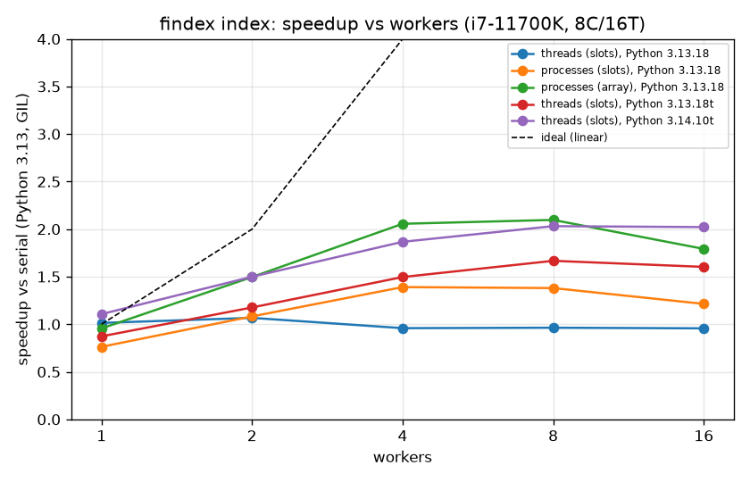

# findex

[](https://github.com/nerb1t/findex/actions/workflows/ci.yml)

**Онлайн:** https://findex-0rmn.onrender.com (сторінка пошуку) · [API-документація](https://findex-0rmn.onrender.com/docs) · [/health](https://findex-0rmn.onrender.com/health). Безкоштовний план Render засинає без відвідувачів, тому перший запит після паузи може йти 30–60 s.

Пошукова система, яку робимо протягом курсу Python. Кожна лаба додає щось нове, тег `lab-01`, `lab-02` і т.д.

## Lab 01 — ітератори, генератори, корпус

### Корпус

18 книг з Project Gutenberg (добірка з NLTK), приблизно 12 МБ. Одна книга = один документ.
Папка `data/` не в git (вона в `.gitignore`), щоб скачати корпус:

```
uv run python scripts/get_corpus.py
```

### Запуск

```
uv sync
uv run pytest
uv run python -m findex.stats data/
uv run python -m findex.stats data/ --limit 5
uv run python -m findex.stats data/ --eager
```

### Файли

- `src/findex/corpus.py` — `iter_documents(root)`, генератор, читає `.txt` файли по одному
- `src/findex/tokenize.py` — `tokenize(text)`, генератор токенів
- `src/findex/stats.py` — статистика (кількість документів, токенів, словник, топ-50, час, пам'ять)
- `tests/test_tokenize.py` — тести

### Правила токенізації

Спочатку `unicodedata.normalize("NFC")`, потім апострофи `’` і `ʼ` замінюються на `'`, потім `casefold()`.
Далі `re.finditer` з регуляркою `[^\W\d_]+(?:['-][^\W\d_]+)*|\d+`.

- слово — це літери (будь-які, кирилиця теж)
- **апострофи** всередині слова залишаються: `don't`, `п'ять`. На краях слова (лапки) — ні
- **дефіси** всередині слова залишаються: `well-known`. `--` це розділювач
- **цифри** — окремий токен, від літер відділяються: `mp3` → `mp`, `3`; `3.14` → `3`, `14`
- все інше (пунктуація, `_`) — розділювачі
- `casefold` замість `lower`, бо `Straße` → `strasse`
- NFC потрібен, бо `é` може бути одним символом або `e` + знак наголосу, без NFC це різні токени

### Eager vs lazy

Eager версія спеціально все тримає в списках: спочатку всі документи в список, потім всі токени в список списків, потім рахує.
Lazy — через генератори.

Весь корпус:

| Version | Documents | Peak memory | Elapsed |
|---|---|---|---|
| eager (lists) | 18 | 122.7 MB | 3.63 s |
| lazy (generators) | 18 | 9.8 MB | 3.73 s |

`--limit 5`:

| Version | Documents | Peak memory | Elapsed |
|---|---|---|---|
| eager (lists) | 5 | 70.5 MB | 2.09 s |
| lazy (generators) | 5 | 9.8 MB | 2.04 s |

В eager версії в пам'яті одночасно лежить текст усіх книг і список з усіх 2.1 млн токенів, а кожен токен це окремий об'єкт `str` (навіть `the` займає ~50 байт) плюс посилання в списку. Тому пам'ять росте разом з корпусом (5 книг — 70 МБ, 18 — 123 МБ).
В lazy версії в кожен момент є тільки один документ і `Counter`, токен рахується і одразу зникає. Тому пам'ять однакова і для 5, і для 18 книг. Нулем вона не буде, бо найбільша книга (Біблія, ~4 МБ) повністю читається в пам'ять разом з копіями після `normalize` і `casefold`, і ще `Counter` на ~48 тисяч слів.

### Проблеми

- У двох книгах (`chesterton-ball.txt`, `shakespeare-caesar.txt`) є биті байти і `read_text` падав з `UnicodeDecodeError`. Зробив `try/except` — якщо помилка, пише warning і читає ще раз з `errors="replace"`.
- `--limit` спочатку хотів зробити як `docs[:5]`, але генератор не можна різати, `TypeError`. Тому `itertools.islice`.
- В eager версії спочатку зробив `list(iter_documents(root))[:limit]`, і з `--limit 5` вона все одно читала всі 18 книг, тобто порівняння було нечесне. Переробив на `list(islice(...))`.

## Lab 02 — інвертований індекс: словники, хешування, пам'ять

### Що зроблено

- `src/findex/models.py` — `Posting`, `DocMeta` (`@dataclass(frozen=True, slots=True)`, хешовані, можна класти в `set`), `PlainPosting` (без slots, тільки для порівняння) і `Index`
- `src/findex/index.py` — `build_index()` і CLI `python -m findex.index`
- `src/findex/search.py` — булевий пошук (AND / OR / NOT), merge двома вказівниками і варіант через `set`, CLI `python -m findex.search`
- `src/findex/store.py` — `save` / `load` у двох форматах: pickle (`.bin`) і json (`.json`)
- `scripts/memory_study.py` — таблиця M4, `scripts/bench_search.py` — merge vs set, `scripts/experiments.py` — експерименти з REPL
- `tests/test_index.py` — тести (побудова, сортування, хешованість, merge == set, пошук, save/load для всіх варіантів)

Класи лежать в окремому `models.py`, а не в `index.py`: при запуску `python -m findex.index` модуль стає `__main__`, і pickle записав би клас як `__main__.Posting`, який потім не знайдеться з `findex.search`.

### Документи = абзаци

18 книг — це лише 18 документів, і найдовший список postings мав би довжину 18, тоді порівнювати merge і set або пам'ять немає сенсу. Тому за замовчуванням кожен **абзац** (текст між порожніми рядками) — окремий документ (`--unit para`). `--unit book` залишає по книзі на документ.

Корпус: 47 887 документів, 48 249 термів, 1 552 841 postings.

### Запуск

```
uv run python -m pytest
uv run python -m findex.index data/ --out index.bin
uv run python -m findex.index data/ --out index.json
uv run python -m findex.index data/ --out index_array.bin --kind array
uv run python -m findex.index data/ --out index_pos.bin --positions
uv run python -m findex.search index.bin "whale ship NOT sea"
uv run python -m findex.search index.bin "elizabeth OR emma NOT darcy" --engine set
uv run python scripts/memory_study.py data/
uv run python scripts/bench_search.py index.bin
uv run python scripts/experiments.py
```

`uv run pytest` у мене на Windows падає з `uv trampoline failed to canonicalize script path`, тому запускаю через `python -m pytest`.

### Як будується індекс

Один прохід: документи йдуть генератором (як в Lab 1), для кожного рахується `Counter(tokenize(text))`, і коли документ закінчився — кожен `(term, tf)` додається в `postings[term]` (`defaultdict(list)`). Оскільки `doc_id` тільки ростуть, кожен список postings вже відсортований, `sort()` не треба. Росте тільки індекс, тексти не накопичуються.

- `postings: dict[str, list[Posting]]`
- `doc_lengths: dict[int, int]` — кількість токенів у документі (для BM25 в Lab 3)
- `doc_meta: dict[int, DocMeta]` — шлях і заголовок (`назва_книги #номер_абзацу: перший рядок`)

З `--positions` у кожному `Posting` ще є `positions: tuple[int, ...]` — номери токенів у документі.

### Запити

Зліва направо, без пріоритетів: `a b` = a AND b, `a OR b c` = (a OR b) AND c, `a NOT b` = a AND NOT b, `NOT a` = всі документи крім a. Оператори пишуться великими літерами, слова проходять через той самий `tokenize`.

Приклад:

```
> uv run python -m findex.search index.bin "whale ship NOT sea" --limit 3
found: 63 documents
  [40253] melville-moby_dick.txt #38: "While the whale is floating at the stern of the ship, they
  [40256] melville-moby_dick.txt #41: "We set sail from the Elbe, wind N.E. in the ship called The
  [40285] melville-moby_dick.txt #70: "My God!  Mr. Chace, what is the matter?"  I answered, "we h
  ... and 60 more
load: 10.92 s, search (set): 0.27 ms
peak memory: 381.3 MB
```

`load` тут довгий, бо CLI міряє пам'ять через `tracemalloc`, а він сповільнює створення мільйонів об'єктів приблизно в 3 рази. Чисті часи завантаження — в таблиці нижче. Той самий запит з `index_array.bin`: load 0.56 s, peak 78.4 MB.

### Merge vs set

Комп'ютер: Intel i7-11700K, Windows 10, Python 3.13. `timeit`, найкращий з 5 замірів, тільки сам алгоритм (списки doc_id вже витягнуті).

| Випадок | Терми (df) | AND merge | AND set | OR merge | OR set |
|---|---|---:|---:|---:|---:|
| 2 найчастіші | `the` (35572), `and` (33096) | 4.27 ms | 4.10 ms | 4.73 ms | 4.23 ms |
| 2 найрідші | `1816` (1), `twenty-one` (1) | 0.1 µs | 0.3 µs | 0.3 µs | 0.3 µs |
| частий + рідкий (на початку) | `the` (35572), `1816` (1) | 0.2 µs | 864.8 µs | 130.2 µs | 1.97 ms |
| частий + рідкий (в кінці) | `the` (35572), `filter'd` (1) | 2.79 ms | 873.1 µs | 3.37 ms | 1.99 ms |

- Обидва способи O(len(a) + len(b)): merge проходить обидва списки, set будує дві хеш-таблиці (+ `sorted` результату).
- **Два великих списки** — майже нічия, set трохи швидший. Merge — це цикл `while` на Python, кожен крок інтерпретується, а `set()` будується в C. Перевагу C частково з'їдає те, що set хешує кожне число і потім сортує результат.
- **Два рідкісних** — все за долі мікросекунди, merge трохи швидший (немає витрат на створення set).
- **Частий + рідкий** — найцікавіше. Merge AND зупиняється, коли короткий список закінчився: якщо рідкий doc_id на початку — 0.2 µs проти 865 µs у set (set все одно хешує всі 35 тисяч чисел). Але якщо рідкий doc_id в кінці, merge мусить пройти майже весь довгий список по одному кроку на Python, і тоді set у 3 рази швидший. Справжні двигуни для цього роблять skip pointers / galloping (стрибати по довгому списку), і тоді merge виграє.
- OR завжди мусить видати всі елементи, тому там set (на C) швидший.

### Memory study (M4)

`uv run python scripts/memory_study.py data/`, той самий корпус (1 552 841 postings). Peak і "в RAM" — через `tracemalloc` (current після побудови = скільки займає готовий індекс). Load — без `tracemalloc`.

| Postings representation | Peak memory (build) | Index in RAM | Build | pickle: size | pickle: save | pickle: load | json: size | json: save | json: load |
|---|---:|---:|---:|---:|---:|---:|---:|---:|---:|
| `list[Posting]`, plain `@dataclass` | 178.1 MB | 176.2 MB | 7.98 s | 38.2 MB | 1.72 s | 1.09 s | 21.3 MB | 4.96 s | 1.73 s |
| `list[Posting]`, `slots=True` | 118.8 MB | 117.0 MB | 8.12 s | 29.3 MB | 5.84 s | 3.18 s | 21.3 MB | 5.36 s | 1.78 s |
| `array('I')` пари (doc_ids, tfs) | **43.0 MB** | **41.2 MB** | 4.92 s | 18.9 MB | 0.25 s | **0.15 s** | 18.6 MB | 1.09 s | 0.40 s |
| `slots=True` + positions | 197.7 MB | 195.9 MB | 11.11 s | 35.1 MB | 6.72 s | 3.68 s | 30.5 MB | 9.97 s | 2.52 s |

**Куди йдуть байти.** Спільна частина для всіх рядків — словник на 48 тисяч термів (рядок-ключ ~50–60 байт + місце в хеш-таблиці) і `doc_meta`/`doc_lengths` на 48 тисяч документів (об'єкт `DocMeta`, рядок заголовка ~100 байт, записи в двох dict) — разом приблизно 15–20 MB (оцінка). Решта — самі postings. Самі числа `doc_id` і `tf` майже нічого не коштують: `tf` майже завжди < 256 (маленькі int у Python кешовані, один об'єкт на всіх), а `doc_id` — один об'єкт int на документ, спільний для всіх його термів. Тобто платимо за обгортки:

- **plain dataclass**: (176 − ~18) / 1.55 млн ≈ **100 байт на posting**: 8 байт вказівник у списку + запас списку при рості, і сам об'єкт. `sys.getsizeof` показує лише 48, але це не все — в Python 3.13 атрибути без slots зберігаються в окремому масиві "inline values" (з запасом під ключі класу), і він не входить у `getsizeof`. Якщо звернутися до `obj.__dict__`, Python створить справжній dict на 296 байт — у старих версіях так було в кожного об'єкта.
- **slots**: ≈ **63 байти на posting**: об'єкт 56 байт (заголовок + 3 слоти по 8 байт + службове для gc) + 8 байт вказівник у списку. Тому slots в 1.5 рази менше. В теорії лаби написано 2–3×, але це для старих версій Python; з 3.11+ звичайні об'єкти вже компактніші, тому різниця менша. Те саме видно в чистому експерименті (1 млн об'єктів з 3 полями): 130 MB проти 92 MB, 1.41×.
- **array('I')**: ≈ **15 байт на posting**: 4 байти doc_id + 4 байти tf, плюс запас масиву при рості і по два об'єкти `array` (~80 байт кожен) + tuple на кожен з 48 тисяч термів. Жодного Python-об'єкта на posting. Без спільної частини це в **~6.5× менше**, ніж plain (≈100 → ≈15 байт), а весь індекс — у 4.3× менше.
- **positions**: tuple з номерами токенів на кожен posting (заголовок tuple + 8 байт на кожну позицію + int-об'єкти для позицій > 256) — індекс росте з 117 до 196 MB, в 1.7×; pickle-файл 29.3 → 35.1 MB, json 21.3 → 30.5 MB. Поки позиції не використовуються (фразовий пошук — Lab 3), тому за замовчуванням вимкнено (`--positions`).

**Файли.** Pickle plain більший за slots (38 vs 29 MB): для звичайного об'єкта зберігається dict атрибутів, а для slots — тільки значення. Але slots-pickle вантажиться втричі довше: для `frozen + slots` dataclass генерує `__setstate__` на Python, який викликається 1.5 млн разів, а plain просто оновлює `__dict__` на C. Array — це просто байти, pickle пише буфер як є, тому 0.15 s. JSON однаковий для plain і slots (там тільки `[doc_id, tf]`), вантажиться швидше за pickle-slots, але зберігається повільно.

### Безпека pickle

`pickle.load` на чужому файлі — це виконання чужого коду. Pickle — не формат даних, а маленька програма: об'єкт може через `__reduce__` сказати "щоб мене відновити, виклич `os.system('...')`", і `pickle.load` це виконає. Тому pickle використовується тільки для нашого власного індексу, який ми самі збудували. Файл, скачаний з інтернету чи отриманий по мережі — тільки json (або інший формат, де є лише дані). Це також написано в коментарі в `store.py`.

### Експерименти (`scripts/experiments.py`)

- `sys.getsizeof(dict)` стрибає після 1, 6, 11, 22, 43 вставок (64 → 224 → 352 → 632 → 1168 → 2264 байт) — це resize, коли таблиця заповнена на ~2/3.
- Клас з `__eq__` без `__hash__` → `TypeError: unhashable type: 'Bad'`. З `__hash__`, що повертає 42: 10 000 перевірок `in` — 2.636 s, з нормальним `hash(self.x)` — 0.002 s (в ~1300 разів повільніше, бо всі ключі колізують і `in` стає O(n)).
- `hash("hello")` у двох процесах: `5833023210499059324` і `-5983259463751001900`. З `PYTHONHASHSEED=0` обидва рази `-2096571579003691106`. Тому хеші рядків не можна зберігати у файл.
- 1 млн об'єктів з 3 полями: 130.1 MB без slots, 92.0 MB зі slots (1.41×).
- `array('I', range(10**6))` — 3.9 MB, `list(range(10**6))` — `getsizeof` показує 7.6 MB, але це тільки масив вказівників. Разом з самими int-об'єктами (по 28 байт) — 38.1 MB.

### Проблеми

- `defaultdict(lambda: ...)` не можна запікліти (lambda не серіалізується), тому в кінці `build_index` перетворюю на звичайний `dict`. Заодно пошук неіснуючого терма не додає порожні записи.
- Перший замір load у `memory_study.py` давав 6.3 s для slots, а окремо — 3 s. Виявилося, що старий індекс ще був у пам'яті, і gc під час завантаження щоразу обходив і його мільйони об'єктів. Тепер індекс видаляється перед замірами load.
- `tracemalloc` сповільнює `pickle.load` приблизно в 3 рази (3.2 s → 10.9 s), тому в таблиці load міряється без нього.
- `¶` у заголовках у консолі Windows виводився кракозябрами, замінив на `#`.
- Перший варіант бенчмарку брав рідкий терм `1816` з doc_id 0, і merge виглядав у 4000 разів швидшим. Додав випадок, де рідкий терм в кінці, — там уже виграє set.
- Stretch (mmap-формат, gap encoding) не робив.

## Lab 03 — ранжування і модель об'єктів: dunder-методи, протоколи, декоратори

### Що зроблено

- `src/findex/models.py` — `Index` тепер клас, наслідує `collections.abc.Mapping[str, list[Posting]]`: `len`, `in`, `index[term]`, `for t in index`, `repr`, плюс `num_docs` (property), `avg_doc_length` (cached_property), `doc_length()`, `df()`, `close()`. У `DocMeta` додались `start`/`end` — де абзац лежить у файлі книги (для сніпетів)
- `src/findex/store.py` — `open_index(path)`, context manager через `@contextmanager`
- `src/findex/scoring.py` — протокол `Scorer` (`typing.Protocol`), `TfIdf` і `BM25(k1=1.5, b=0.75)`
- `src/findex/query.py` — лексер + парсер рекурсивним спуском, вузли `Term`, `Phrase`, `And`, `Or`, `Not` з `&`, `|`, `~` і `evaluate(index)`
- `src/findex/search.py` — `Searcher.search(query, scorer, k)`: булевий фільтр → бали → `heapq.nlargest`, результат — `SearchResult` з `order=True`; CLI
- `src/findex/decorators.py` — `@timed` (з `functools.wraps`)
- `src/findex/snippet.py` — сніпети з підсвіткою
- `src/findex/merge.py` — merge / set з Lab 2 переїхали сюди (щоб не було циклічного імпорту `search` ↔ `query`)
- `scripts/sanity.py` — три перевірки ранжування, `scripts/evaluate.py` + `scripts/qrels.json` — precision@5, `scripts/experiments_lab3.py` — експерименти
- `tests/test_lab3.py` — 31 новий тест (всього 61)

Старі `index*.bin` з Lab 2 треба перебудувати: там запікльований старий клас `Index`.

### Запуск

```
uv run python -m pytest
uv run python -m findex.index data/ --out index_pos.bin --positions
uv run python -m findex.search index_pos.bin '(ahab OR starbuck) "white whale" NOT ship'
uv run python -m findex.search index_pos.bin "captain ahab" --scorer tfidf -k 3
uv run python -m findex.search index_pos.bin --color          (інтерактивний режим, порожній рядок - вихід)
uv run python scripts/sanity.py index_pos.bin
uv run python scripts/evaluate.py index_pos.bin
uv run python scripts/experiments_lab3.py
```

Фрази працюють тільки з індексом, збудованим з `--positions` (інакше `query error: phrase search needs an index built with --positions`). `-k` — скільки результатів показати (замість `--limit` з Lab 2), `-q` — без логів.

### Index як об'єкт

```python
>>> from findex.store import open_index
>>> with open_index("index_pos.bin") as ix:
...     print(ix, len(ix), "whale" in ix, ix.df("whale"), round(ix.avg_doc_length, 1))
...     print(ix["whale"][:2])
Index(terms=48_249, docs=47_887, kind='slots') 48249 True 595 45.4
[Posting(doc_id=15385, tf=1, positions=(8,)), Posting(doc_id=22385, tf=1, positions=(64,))]
>>> ix.closed, len(ix)
(True, 0)
```

Від `Mapping` безкоштовно є `keys()`, `items()`, `values()`, `get()`. `__eq__` повертає `NotImplemented` для чужих типів. `open_index` закриває індекс у `finally`, тобто і при винятку всередині `with` (є тест `test_open_index_exception`).

### Мова запитів

```
or_expr  := and_expr ("OR" and_expr)*
and_expr := not_expr (["AND"] not_expr)*
not_expr := "NOT" not_expr | atom
atom     := слово | "фраза" | "(" or_expr ")"
```

AND сильніше за OR, бо `and_expr` сидить усередині `or_expr`: парсер спочатку збирає `b c` в And, а вже потім бачить OR. Тому `a OR b c` = `Or(a, And(b, c))`. Тести порівнюють дерева, а не рядки:

```python
assert parse("a OR b c") == Or(Term("a"), And(Term("b"), Term("c")))
assert parse('python AND (async OR await) NOT java "event loop"') == And(
    And(And(Term("python"), Or(Term("async"), Term("await"))), Not(Term("java"))),
    Phrase(("event", "loop")),
)
assert Term("a") & (Term("b") | Term("c")) & ~Term("d") == parse("a (b OR c) NOT d")
```

Фраза: беремо документи, де є всі слова (merge AND), потім для кожного документа зсуваємо позиції першого слова на +1 і робимо merge AND з позиціями другого, і т.д. Якщо щось залишилось — фраза є. `a AND NOT b` рахується як `merge_not(a, b)`, без побудови доповнення до b.

### Ранжування

Бали рахуються тільки для документів, які пройшли булевий фільтр, по всіх "позитивних" термах запиту (те, що під NOT, не рахується). Для кожного терма йдемо по postings і робимо `scores[doc_id] += scorer(term, posting, index)`, потім `heapq.nlargest(k, ...)` — O(n log k) замість O(n log n) у `sorted(...)[:k]`.

- TF-IDF: `tf · log(N / df)`
- BM25: `idf · tf·(k1+1) / (tf + k1·(1 − b + b·dl/avgdl))`, `idf = log(1 + (N − df + 0.5)/(df + 0.5))`

`Scorer` — це `Protocol` з `__call__(term, posting, index) -> float`, тому підходять і `TfIdf()`, і `BM25()`, і звичайна функція. `avg_doc_length` — `cached_property`, бо BM25 питає його для кожного posting.

### Три перевірки на корпусі (`scripts/sanity.py`)

**1. Рідкий терм вище частого.** Запит `the OR leviathan`: df(`the`) = 35 572, idf = 0.30; df(`leviathan`) = 81, idf = 6.38.

| | Найкращий документ | BM25 | Місце |
|---|---|---:|---:|
| тільки `leviathan` | melville-moby_dick.txt #32: "By art is created that great Leviathan..." | 10.56 | 1 |
| тільки `the` | whitman-leaves.txt #677: I see the long river-stripes of the earth, | 0.67 | 80 |

Найгірший документ тільки з `leviathan` має 7.99 — все одно вище за найкращий тільки з `the` (0.67). Всі документи з `leviathan` стоять вище за всі, де є тільки `the`.

**2. 20-те повторення майже нічого не додає.** Терм `whale`, документ середньої довжини (45 токенів, avgdl = 45.4):

| tf | BM25 | + за цей повтор | TF-IDF | + за цей повтор |
|---:|---:|---:|---:|---:|
| 1 | 4.404 | +4.404 | 4.39 | +4.39 |
| 2 | 6.285 | +1.881 | 8.78 | +4.39 |
| 3 | 7.328 | +1.043 | 13.16 | +4.39 |
| 5 | 8.449 | +0.459 | 21.94 | +4.39 |
| 10 | 9.545 | +0.136 | 43.88 | +4.39 |
| 19 | 10.170 | +0.041 | 83.37 | +4.39 |
| 20 | 10.207 | +0.037 | 87.76 | +4.39 |

У BM25 20-й повтор дає +0.037 — це 0.8% від першого. Межа при tf → ∞ — idf·(k1+1) = 11.0. У TF-IDF кожен повтор дає однаково, тому документ з 20 `whale` у 20 разів "кращий" за документ з одним. (На корпусі найбільше `whale` в одному абзаці — 13, у `melville-moby_dick.txt #723`.)

**3. Короткий документ вище довгого.** Обидва з одним `whale`:

| Документ | Довжина | tf | BM25 | TF-IDF |
|---|---:|---:|---:|---:|
| melville-moby_dick.txt #1898: "WHAT whale?" | 2 | 1 | 7.70 | 4.39 |
| melville-moby_dick.txt #2615: "Oh, Starbuck! it is a mild, mild wind..." | 523 | 1 | 0.76 | 4.39 |

TF-IDF довжину не бачить (однаковий бал), BM25 дає короткому в 10 разів більше. З `b = 0` різниці не було б (є тест).

### @timed і кеш

`@timed` стоїть на `build_index`, `load`, `Searcher.search` і `Searcher._match`. `lru_cache(maxsize=256)` — на шляху "дерево запиту → doc_ids" (`Searcher.match`). Ключ кешу — саме дерево (frozen dataclass, хешується), тому `a  b` і `a b` — один і той самий запис. Лог з двома однаковими запитами (другий з іншими пробілами):

```
> uv run python -m findex.search index_pos.bin '(ahab OR starbuck) "white whale" NOT ship' '(ahab OR starbuck)  "white whale" NOT ship' 'captain ahab' -k 3
  [findex.timed] load took 3715.1 ms
Index(terms=48_249, docs=47_887, kind='slots') loaded in 3.72 s
  [findex.timed] Searcher._match took 0.5 ms
  [findex.search] match (((ahab OR starbuck) AND "white whale") AND NOT ship) -> 38 docs (cache miss)
  [findex.timed] Searcher.search took 1.1 ms
query: (((ahab OR starbuck) AND "white whale") AND NOT ship)   scorer: BM25(k1=1.5, b=0.75)
 1. [ 21.21] melville-moby_dick.txt #2319: "Hast seen the White Whale?" gritted Ahab in reply.
    "Hast seen the **White** **Whale**?" gritted **Ahab** in reply.
 2. [ 20.27] melville-moby_dick.txt #813: "Moby Dick?" shouted Ahab.  "Do ye know the white whale then
    "Moby Dick?" shouted **Ahab**. "Do ye know the **white** **whale** then, Tash?"
 3. [ 19.98] melville-moby_dick.txt #1519: "Hast thou seen the White Whale?" demanded Ahab, when the bo
    "Hast thou seen the **White** **Whale**?" demanded **Ahab**, when the boat drifted back.

  [findex.search] match (((ahab OR starbuck) AND "white whale") AND NOT ship) -> 38 docs (cache hit)
  [findex.timed] Searcher.search took 0.3 ms
  ...
  [findex.timed] Searcher._match took 0.2 ms
  [findex.search] match (captain AND ahab) -> 77 docs (cache miss)
  [findex.timed] Searcher.search took 0.4 ms
  ...
CacheInfo(hits=1, misses=2, maxsize=256, currsize=2)
```

На другому запиті немає рядка `Searcher._match took` — функція взагалі не викликалась, відповідь взята з кешу.

### Сніпети

Вікно ±80 символів навколо "найкращого" входження — того, навколо якого у вікні найбільше різних термів запиту. Текст абзацу читається з файлу книги за `DocMeta.start/end` (книги кешуються `lru_cache`). Токени шукаються тією ж регуляркою, що в `tokenize`, але в тексті без `casefold`, щоб позиції збігались з оригіналом. Підсвітка — `**слово**`, з `--color` — жовтим (ANSI). Приклад для довгого абзацу (`captain ahab --scorer tfidf -k 1`):

```
query: (captain AND ahab)   scorer: TfIdf()
 1. [ 41.18] melville-moby_dick.txt #434: "Come hither to me--hither, hither," said Peleg, with a sign
    ...e. "Look ye, lad; never say that on board the Pequod. Never say it anywhere. **Captain** **Ahab** did not name himself. 'Twas a foolish, ignorant whim of his crazy, widowe...
```

### Оцінка: precision@5

10 запитів, для кожного розмічені руками документи з об'єднання топ-10 TF-IDF і топ-10 BM25 (`scripts/evaluate.py --pool`), розмітка в `scripts/qrels.json`. Критерій: документ релевантний, якщо він **про** те, що питається (описує героя / сцену / стосунки), а не просто згадує обидва слова.

| # | Запит | Що шукаю | Релевантних | P@5 TF-IDF | P@5 BM25 |
|---:|---|---|---:|---:|---:|
| 1 | `white whale` | опис Мобі Діка, ставлення до нього | 9 | 0.8 | 0.0 |
| 2 | `captain ahab` | що розповідають про Ахава | 8 | 0.8 | 0.0 |
| 3 | `alice rabbit` | сцени Аліси з Кроликом | 12 | 1.0 | 1.0 |
| 4 | `hamlet ghost` | Гамлет і Привид | 7 | 1.0 | 1.0 |
| 5 | `lady macbeth` | сцени леді Макбет | 5 | 1.0 | 1.0 |
| 6 | `father brown` | що робить / який отець Браун | 9 | 1.0 | 0.0 |
| 7 | `emma harriet` | стосунки Емми і Гаррієт | 13 | 1.0 | 0.2 |
| 8 | `brutus OR cassius` | Брут / Кассій у дії | 14 | 1.0 | 0.2 |
| 9 | `anne wentworth` | Енн і капітан Вентворт | 14 | 0.8 | 0.6 |
| 10 | `jesus disciples` | Ісус з учнями | 18 | 1.0 | 1.0 |
| | **середнє** | | | **0.94** | **0.50** |

Несподівано: BM25 програв. Причина видно з `--pool`: документ = абзац, середня довжина 45 токенів, а в книгах купа діалогових рядків на 2–6 слів (`"Captain Ahab."`, `"Father Brown?" she said.`, `Manet Brutus and Cassius.`). Нормалізація довжини з `b = 0.75` дає таким рядкам величезний бонус (як у перевірці 3: 2 токени → 7.70, 523 токени → 0.76), і весь топ-5 BM25 займають одно-рядкові репліки, де обидва слова є, але інформації нуль. TF-IDF з сирим `tf` навпаки любить довгі абзаци з багатьма повторами — а за моїм критерієм саме вони "про" героя. На запитах, де всі збіги і так змістовні (Аліса, Гамлет, Біблія), обидва дають 1.0.

Те саме з різним `b` (документи, яких немає в розмітці, рахуються нерелевантними, тому це тільки приблизно):

| BM25 b | 0.75 | 0.5 | 0.3 | 0.0 |
|---|---:|---:|---:|---:|
| P@5 | 0.50 | 0.56 | 0.76 | 0.94 |

Тобто для такого корпусу (дуже різні довжини абзаців, багато коротких реплік) `b` треба брати меншим. Вибірка маленька (10 запитів, розмічав сам), тому висновок шумний — але звичка міряти ранжування якраз для цього.

### Експерименти (`scripts/experiments_lab3.py`)

- `len(V())` без `__len__` → `TypeError: object of type 'V' has no len()`. З `__len__ = 3`: `len = 3`, `bool = True` — `bool()` шукає `__bool__`, а якщо його немає, бере `__len__() != 0`. З `__len__ = 0` → `False`.
- Декоратор без `functools.wraps`: `search.__name__ == "wrapper"`, `__doc__ = None`. З `wraps`: `search`, `Шукає q.`
- `dis`: `len(x)` — це `LOAD_GLOBAL len`, `LOAD_GLOBAL x`, `CALL 1`; `x.__len__()` — `LOAD_ATTR __len__`, `CALL 0`. `len()` для списку одразу бере довжину з C-структури, а `x.__len__()` спочатку шукає атрибут і створює bound method. 1 млн викликів: `len(list)` 0.019 s, `list.__len__()` 0.036 s.
- `@lru_cache` зі списком → `TypeError: unhashable type: 'list'` (ключ кешу — це хеш аргументів), з tuple працює.
- `@contextmanager`: при `return` всередині `with` і при винятку `exit` друкується (бо `finally`), виняток йде далі.

### Проблеми

- Lab 2 `search.py` імпортував би `query.py`, а `query.py` — merge-функції з `search.py`: циклічний імпорт. Виніс merge/set в `merge.py`.
- `heapq.nlargest` при однакових балах зберігає порядок вставки, і тест `results == sorted(results, reverse=True)` падав (при рівних балах `sorted` ставить більший `doc_id` першим). Зробив ключ `(score, -doc_id)`: при рівних балах вище менший `doc_id`, результат стабільний.
- Логи `@timed` йдуть в stderr, а результати в stdout, тому при перенаправленні у файл вони перемішуються не по порядку. Для прикладу в README запускав з `python -u`.
- Для сніпетів потрібен текст абзацу, а в індексі його немає. Зберігати тексти — +12 MB, тому зберігаю тільки `start/end` у файлі книги і читаю книгу при показі. Для цього `PARA_RE.split` замінив на `finditer`, щоб знати межі.
- Stretch (`ResultList` як `Sequence`, `explain` через `singledispatch`) не робив.

## Lab 04 — справжній інструмент: типи, тести, пакування, CLI

### Встановлення

```
uv tool install .                                   # з папки репозиторію
uv tool install dist/findex-0.4.0-py3-none-any.whl  # або з wheel (uv build)
uv tool install https://github.com/nerb1t/findex/releases/download/v0.4.0/findex-0.4.0-py3-none-any.whl
findex --help
```

Після цього `findex` є в PATH (`~/.local/bin/findex`), і запускається з будь-якої папки. Без встановлення — `uv run findex ...` або `uv run python -m findex ...` з папки репозиторію.

З Lab 4 старі `python -m findex.index` / `python -m findex.search` / `python -m findex.stats` прибрані: вся логіка лишилась у модулях, а вивід і аргументи тепер тільки в `cli.py`.

### Команди

```
findex index data/ --out index_pos.bin --positions        # смуга прогресу rich (у stderr)
findex index data/ --out small.json --limit 3             # тільки перші 3 книги, формат json
findex search index_pos.bin '(ahab OR starbuck) "white whale" NOT ship' -k 3
findex search index_pos.bin "captain ahab" --scorer tfidf --engine set
findex search index_pos.bin "captain ahab" --json -k 5 | jq .title
findex stats index_pos.bin --top 5
findex -v search ...      # INFO: що знайдено, cache hit/miss
findex -vv search ...     # DEBUG: ще й час кожної функції з @timed
```

Приклад (`COLUMNS=110`, запуск з іншої папки, з установленого wheel):

```
                        (((ahab OR starbuck) AND "white whale") AND NOT ship)  (bm25)
┌───┬───────┬──────────────────────────────┬────────────────────────────────────────────────────────────────┐
│ # │ score │ document                     │ snippet                                                        │
├───┼───────┼──────────────────────────────┼────────────────────────────────────────────────────────────────┤
│ 1 │ 21.21 │ melville-moby_dick.txt #2319 │ "Hast seen the White Whale?" gritted Ahab in reply.            │
├───┼───────┼──────────────────────────────┼────────────────────────────────────────────────────────────────┤
│ 2 │ 20.27 │ melville-moby_dick.txt #813  │ "Moby Dick?" shouted Ahab. "Do ye know the white whale then,   │
│   │       │                              │ Tash?"                                                         │
├───┼───────┼──────────────────────────────┼────────────────────────────────────────────────────────────────┤
│ 3 │ 19.98 │ melville-moby_dick.txt #1519 │ "Hast thou seen the White Whale?" demanded Ahab, when the boat │
│   │       │                              │ drifted back.                                                  │
└───┴───────┴──────────────────────────────┴────────────────────────────────────────────────────────────────┘
```

(у терміналі слова з запиту підсвічені жовтим). `--json` — один JSON-об'єкт на рядок, тільки в stdout:

```
{"rank": 1, "score": 15.9694, "doc_id": 40728, "title": "melville-moby_dick.txt #513: \"Captain Ahab.\"", "path": "C:\\...\\melville-moby_dick.txt", "snippet": "\"Captain Ahab.\""}
```

`findex stats index_pos.bin`: 18 книг, 47 887 документів, 2 173 378 токенів, словник 48 249, 1 552 841 postings, середня довжина 45.4, топ: `the` 133 583, `and` 95 365, `of` 71 229 — ті самі числа, що в Lab 1.

**Помилки.** Очікувані помилки — один рядок у stderr і код 1, без traceback:

```
> findex search nope.bin x
error: index file not found: nope.bin            (exit 1)
> findex search index_pos.bin "(whale"
error: bad query: missing ')'                    (exit 1)
> findex search index.bin '"white whale"'        (індекс без --positions)
error: phrase search needs an index built with --positions
> findex search bad.bin x                        (не індекс / старий формат)
error: bad.bin is not a findex index (UnpicklingError: ...)
```

Неправильні аргументи (`--scorer magic`) ловить сам typer — код 2. Корпус перевіряється (`exists=True, file_okay=False`).

**stdout і stderr.** stdout — тільки дані (таблиця або JSON), stderr — логи, смуга прогресу, помилки. Тому `findex search ... --json | jq` працює навіть з `-vv` (є тест `test_verbose_logs_go_to_stderr`).

### Типи і pyright strict

`[tool.pyright] typeCheckingMode = "strict"` для `src/` і `tests/`: **0 errors, 0 warnings**. Що для цього зроблено:

- всі функції й методи анотовані; `list[str]`, `dict[str, list[Posting]]`, `X | None` замість `Optional`
- аліаси PEP 695: `type DocId = int`, `type Kind = Literal["plain", "slots", "array"]`, `type Engine = Literal["merge", "set"]`, `type ScorerName = Literal["bm25", "tfidf"]`, `type Unit = Literal["para", "book"]`. typer читає ці `Literal` і сам перевіряє значення опцій
- генератори: `iter_documents -> Iterator[Document]`, `iter_units(docs: Iterable[Document]) -> Iterator[TextUnit]` — приймаємо `Iterable`, повертаємо `Iterator`
- `Scorer` — `typing.Protocol` з `__call__(term, posting, index) -> float`. `TfIdf` і `BM25` від нього не наслідуються; pyright перевіряє їх у `make_scorer(name) -> Scorer` і в тестах (`scorers: list[Scorer] = [TfIdf(), BM25(), my_scorer]`)
- `timed[**P, R](fn: Callable[P, R]) -> Callable[P, R]` — PEP 695 generics з ParamSpec, тому після `@timed` pyright знає справжню сигнатуру функції
- `Index(Mapping[str, list[AnyPosting]])`; для `kind="array"` дані тепер в окремому полі `arrays: dict[str, tuple[array[int], array[int]]]`, бо один dict з двома різними типами значень pyright не може звузити за `self.kind`
- JSON-файл описаний `TypedDict` (`IndexJson`); `pickle.load` повертає `Any`, тому перевіряю `isinstance(obj, Index)`
- merge-функції приймають `Sequence[int]` — підходять і `list`, і `array('I')`

Escape hatches: **один `cast`** (`store.py`: `json.load` повертає `Any`, файл ми писали самі — коментар поруч) і **один `# type: ignore[misc]`** (`tests/test_index.py`: навмисно присвоюю полю frozen dataclass, щоб перевірити `AttributeError`). Більше жодного.

Експеримент: `def count(x: str) -> int: return x` — Python спокійно друкує `hello`, а pyright: `Type "str" is not assignable to return type "int"`. `def up(x: str | None): return x.upper()` → `"upper" is not a known attribute of "None" (reportOptionalMemberAccess)`; після `if x is None: return ""` помилка зникає — це narrowing.

### Тести

**113 тестів** (`uv run python -m pytest`), за 7 s; `-m "not slow"` — 108 тестів за 2.3 s.

| Файл | Що перевіряє |
|---|---|
| `conftest.py` | фікстури: маленький корпус (2 книги, 4 абзаци) і індекс з `scope="session"`; `real_index` — 3 справжні книги (skip, якщо немає `data/`) |
| `test_tokenize.py` | токенізатор, `parametrize` на 15 випадків: кирилиця, грецька (`ΣΊΣΥΦΟΣ` → `σίσυφοσ`), ієрогліфи, `Straße`, комбінований наголос, апострофи, дефіси, цифри; биті utf-8 байти |
| `test_index.py` | побудова (абзаци/книги, `--limit`, callback прогресу, позиції, array), merge, булеві запити обома engine, save/load у всіх варіантах, биті файли → `StoreError` |
| `test_lab3.py` | dunder-методи `Index`, `open_index` з винятком, дерева парсера, `&` `|` `~`, три перевірки скорерів, кеш, `@timed` + `wraps`, сніпети |
| `test_properties.py` | Hypothesis (6 властивостей, нижче) |
| `test_cli.py` | усі команди через `typer.testing.CliRunner`: таблиця, `--json`, коди виходу, помилки одним рядком, логи тільки в stderr, `-v` / `-vv` |
| `test_real.py` | `slow`: три перевірки ранжування і фраза на справжньому корпусі |

**Hypothesis** (`tests/test_properties.py`):

1. `load(save(index)) == index` для випадкових корпусів, з позиціями і без, pickle і json (`slow`, ~2–3 s)
2. postings завжди строго зростають за `doc_id`, `tf == len(positions)`, а сума tf документа = його довжина
3. оракул: `merge_and/or/not(a, b) == sorted(set(a) & | - set(b))` для будь-яких відсортованих списків
4. `tokenize` ніколи не дає порожній токен і `tokenize(" ".join(tokens)) == tokens`
5. будь-яке дерево запиту: `parse(str(tree)) == tree`
6. `tree.evaluate(index, "merge") == tree.evaluate(index, "set")` для випадкових індексу і дерева

Чесно: Hypothesis нічого не знайшов — усі властивості пройшли з першого разу (в т.ч. на довільному Unicode з `st.text()`). Зате знайшов баг ручний запуск з іншої папки, див. "Проблеми".

**Покриття** (`uv run python -m pytest --cov=findex --cov-report=term-missing`): **98%** (780 рядків, 18 не покрито).

| Модуль | Cover | Що не покрито і чому |
|---|---:|---|
| `stats.py` | 64% | `lazy_stats` / `eager_stats` з Lab 1 — їх використовує тільки `scripts/bench.py` |
| `__main__.py` | 0% | два рядки для `python -m findex`; CLI тестується напряму через `app` |
| `models.py` | 98% | `avg_doc_length` порожнього індексу, `num_postings` для array (тільки в `memory_study.py`) |
| `query.py` | 99% | `Node.evaluate` базового класу — там тільки `raise NotImplementedError` |
| `search.py` | 98% | `Searcher.__repr__` |
| решта | 100% | |

На CI немає `data/`, тому 4 тести з `test_real.py` там skipped.

### Пакування

- `pyproject.toml` (PEP 621): `version = "0.4.0"`, залежності `typer`, `rich`; група `dev`: `pytest`, `pytest-cov`, `hypothesis`, `pyright`, `ruff`; налаштування `ruff`, `pytest` (маркер `slow`), `pyright`, `coverage`
- `[project.scripts] findex = "findex.cli:app"` — у wheel це `entry_points.txt` з `[console_scripts]`, а при встановленні uv кладе в `~/.local/bin` маленький `findex.exe`, який імпортує `findex.cli` і викликає `app()`
- `uv.lock` у git — точні версії для `uv sync --locked` (так робить CI)
- `src/` layout: тести імпортують встановлений пакет, а не файли з поточної папки
- `uv build` → `dist/findex-0.4.0-py3-none-any.whl` (в ньому тільки `findex/*.py` і `dist-info`); перевірено `uvx --from dist/findex-0.4.0-py3-none-any.whl findex --version` → `findex 0.4.0` і `uv tool install` з wheel із іншої папки

### Логування

`log = logging.getLogger(__name__)` у кожному модулі, налаштування — один раз у `cli.py` (callback `main`): `RichHandler` у stderr, рівень WARNING / INFO (`-v`) / DEBUG (`-vv`). Діагностичних `print` у `src/` більше немає (`print` лишився тільки для `--json` — це дані). `@timed` пише в DEBUG, cache hit/miss — в INFO, биті utf-8 — WARNING. Форматування лінивим `%`: `log.info("match %s -> %d docs", tree, n)` — рядок збирається, тільки якщо рівень увімкнений.

```
> findex -vv search index_pos.bin "captain ahab" --json -k 1
DEBUG    findex.decorators: load took 3929.0 ms
DEBUG    findex.decorators: Searcher._match took 0.2 ms
INFO     findex.search: match (captain AND ahab) -> 77 docs (cache miss)
DEBUG    findex.decorators: Searcher.search took 2.4 ms
{"rank": 1, "score": 15.9694, ...}
```

### CI

`.github/workflows/ci.yml` на кожен push і PR: `uv sync --locked` → `ruff check` → `ruff format --check` → `pyright` → `pytest --cov`. Бейдж — на початку README.

### Проблеми

- **Відносні шляхи в індексі.** `findex index data/` записував у `DocMeta.path` шлях `data\gutenberg\...`, і `findex search` з іншої папки падав з `FileNotFoundError` на сніпеті (з traceback!). Знайшов тільки коли запустив встановлений `findex` не з репозиторію. Тепер шлях абсолютний (`resolve()`), а якщо книгу потім видалили — сніпет порожній і warning у лог.
- **Перевстановлення на Windows.** `uv tool install --force` (і `uv tool uninstall`) поверх уже встановленого findex падали з `failed to remove directory ...\uv\tools\findex\Lib (os error 32)` і лишали зламане оточення: папка `annotated_doc` порожня, `findex` падає з `ImportError`. Перше встановлення "з нуля" працює. Обхід: перейменувати і видалити `%APPDATA%\uv\tools\findex` вручну, потім знову `uv tool install dist/findex-0.4.0-py3-none-any.whl`.
- Для `kind="array"` раніше `postings` містив то списки `Posting`, то пари `array` — pyright strict такого не пропускає. Розніс у два поля `postings` і `arrays`.
- `rich` сприймає `[...]` у тексті як розмітку: заголовок `[Emma by Jane Austen 1816]` просто зник би. Тому всі дані в таблиці — `Text(...)`, а не рядки.
- `rich` переносить довгі рядки по ширині терміналу, і повідомлення про помилку з довгим шляхом ставало двома рядками. Для помилок `soft_wrap=True`.
- `scripts/bench.py` з Lab 1 імпортував функції, яких не було в `stats.py` — виправив.
- Stretch (completion, `findex config`, free-threaded CI, TestPyPI) не робив.

## Lab 05 — конкурентність і GIL: потоки, процеси, паралельна індексація

### Що зроблено

- `src/findex/parallel.py` — map-reduce:
  - `make_tasks(paths)` ділить корпус на задачі `Task(path, part, parts)` приблизно по 256 КБ (`--chunk-kb`). Велику книгу ріжемо на частини по абзацах: Біблія (4.1 MB) — це 17 задач, а не одна, інакше один воркер пів часу сидів би на ній. Усього 51 задача.
  - `build_partial(task) -> PartialIndex` — функція рівня модуля (її можна передати в інший процес). Воркер отримує лише шлях і номер частини, сам читає файл і повертає компактний результат: на кожен терм два `array('I')` (локальні doc_id і tf), а не мільйони об'єктів `Posting`.
  - `merge(partials) -> Index` — послідовний reduce. Частини йдуть у порядку корпусу, кожна отримує діапазон doc_id `[offset, offset + n)`, і postings просто дописуються в кінець, тож лишаються відсортованими.
  - `run_tasks(tasks, pool)` — однаковий код для звичайного циклу, `ThreadPoolExecutor` і `ProcessPoolExecutor` (`submit` + `as_completed`, результати повертаються в правильному порядку)
- `findex index ... --executor {serial,threads,processes} --workers N --chunk-kb K`. Типово: `processes`, `min(8, os.cpu_count())` воркерів (бо так швидше, див. таблицю)
- `scripts/bench_parallel.py` (таблиця й графік), `scripts/bench_io.py` (I/O-дослід), `scripts/experiments_lab5.py`
- `tests/test_parallel.py` — 21 тест (усього 134, з них 1 skip)

**Чому doc_id призначаються в merge, а не наперед.** У завданні сказано роздати кожному шматку діапазон doc_id заздалегідь. Але документ у нас — абзац, і скільки абзаців у шматку, стає відомо лише після читання файлу (а читати мають воркери, не батько). Тому воркер нумерує свої документи 0, 1, 2…, а `merge` зсуває їх на `offset` — суму документів у попередніх шматках. Шматки йдуть у фіксованому порядку, тож результат той самий, що й при призначенні наперед.

**Той самий індекс.** `merge([build_partial(...)])` для всіх шматків дає індекс, рівний `build_index` з Lab 4. Більше того, `pickle.dumps` обох індексів **збігається байт у байт** для `serial`, `threads` і `processes`, з позиціями й без, для `slots`/`plain`/`array` (`test_serial_merge_equals_lab4`, `test_parallel_byte_identical`). Для цього в `merge` довелося використовувати один об'єкт `str` шляху на книгу, а не окремий на кожну частину: інакше pickle записував би шлях кілька разів і байти розходились.

**Помилка у воркері.** Якщо `build_partial` падає (наприклад, файл зник), `fut.result()` кидає той самий виняток. Решта задач скасовується, і збірка падає з traceback. У процесах `ProcessPoolExecutor` додає стек воркера як `__cause__`, тому видно рядок у `build_partial`, де сталася помилка (`test_worker_exception_surfaces`). Нічого не зависає.

**spawn.** На Windows `ProcessPoolExecutor` запускає воркери через `spawn`: це новий інтерпретатор, який заново імпортує головний модуль. Тому в `src/findex/__main__.py` тепер стоїть `if __name__ == "__main__": app()`, інакше `python -m findex index ...` кожен воркер знову запускав би CLI. Скрипт `findex.exe`, який генерує uv, захищений так само.

### Бенчмарк

**Машина:** Intel Core i7-11700K, 8 ядер / 16 потоків, 3.6 GHz, 16 GB RAM, Windows 10 Pro, SSD. Python 3.13.18 (GIL), 3.13.18t і 3.14.10t (free-threaded, `uv python install 3.13t 3.14t`).

**Методика:** повний корпус (18 книг, 11.8 MB, 47 887 документів, 1.55 млн postings), `kind=slots`, без позицій. Кожен запуск — окремий процес Python, щоб пік RSS і кеші одного запуску не впливали на інший. Спочатку один розігрівний запуск (файли потрапляють у кеш ОС), потім **3 запуски на кожну конфігурацію**, у таблиці медіана. Час — `time.perf_counter()`. CPU — `psutil`: CPU батька плюс CPU усіх воркерів, заміряний перед закриттям пулу (тобто разом зі стартом процесів і pickle). Peak RSS — пік working set батька (`psutil ... peak_wset`). «RSS воркерів» — сума RSS усіх воркерів наприкінці. Merge міряється окремо.

```
uv run python scripts/bench_parallel.py run data/ --out results/py313.json
.venv-313t/Scripts/python.exe scripts/bench_parallel.py run data/ --out results/py313t.json --threads-only
.venv-314t/Scripts/python.exe scripts/bench_parallel.py run data/ --out results/py314t.json --threads-only
uv run python scripts/bench_parallel.py report results/*.json
```

Speedup рахується відносно `serial` на звичайному Python 3.13 (3.19 s).

| Python | Executor | kind | Workers | Wall, s (median) | min–max | CPU, s | Peak RSS батька | RSS воркерів | Merge, s | Speedup |
|---|---|---|---:|---:|---:|---:|---:|---:|---:|---:|
| 3.13 | serial | slots | 1 | **3.19** | 3.08–3.28 | 3.5 | 295 MB | — | 1.17 | 1.00× |
| 3.13 | threads | slots | 1 | 3.14 | 3.02–3.33 | 3.4 | 295 MB | — | 1.26 | 1.01× |
| 3.13 | threads | slots | 2 | 2.99 | 2.98–3.19 | 3.3 | 295 MB | — | 1.15 | 1.07× |
| 3.13 | threads | slots | 4 | 3.32 | 3.17–3.32 | 3.6 | 295 MB | — | 1.25 | 0.96× |
| 3.13 | threads | slots | 8 | 3.31 | 3.29–3.45 | 3.7 | 295 MB | — | 1.22 | 0.96× |
| 3.13 | threads | slots | 16 | 3.33 | 3.33–3.36 | 3.6 | 295 MB | — | 1.24 | 0.96× |
| 3.13 | processes | slots | 1 | 4.18 | 4.12–4.21 | 4.7 | 299 MB | 26 MB | 1.21 | 0.76× |
| 3.13 | processes | slots | 2 | 2.94 | 2.94–3.12 | 5.2 | 299 MB | 52 MB | 1.20 | 1.08× |
| 3.13 | processes | slots | 4 | **2.29** | 2.10–2.32 | 5.6 | 299 MB | 102 MB | 1.15 | **1.39×** |
| 3.13 | processes | slots | 8 | 2.31 | 2.26–2.32 | 7.9 | 299 MB | 203 MB | 1.21 | 1.38× |
| 3.13 | processes | slots | 16 | 2.62 | 2.56–2.63 | 13.2 | 299 MB | 393 MB | 1.23 | 1.21× |
| 3.13 | processes | array | 1 | 3.33 | 3.25–3.38 | 4.0 | 162 MB | 26 MB | 0.40 | 0.96× |
| 3.13 | processes | array | 2 | 2.13 | 2.10–2.19 | 4.4 | 163 MB | 52 MB | 0.37 | 1.50× |
| 3.13 | processes | array | 4 | 1.55 | 1.54–1.64 | 5.1 | 163 MB | 102 MB | 0.37 | 2.06× |
| 3.13 | processes | array | 8 | **1.52** | 1.49–1.55 | 7.3 | 162 MB | 202 MB | 0.37 | **2.10×** |
| 3.13 | processes | array | 16 | 1.78 | 1.76–1.80 | 12.0 | 162 MB | 397 MB | 0.38 | 1.79× |
| 3.13t | serial | slots | 1 | 3.61 | 3.60–3.70 | 4.1 | 331 MB | — | 1.30 | 0.88× |
| 3.13t | threads | slots | 1 | 3.65 | 3.60–3.67 | 4.2 | 332 MB | — | 1.31 | 0.87× |
| 3.13t | threads | slots | 2 | 2.71 | 2.66–2.75 | 4.3 | 333 MB | — | 1.30 | 1.18× |
| 3.13t | threads | slots | 4 | 2.13 | 2.09–2.19 | 4.5 | 336 MB | — | 1.24 | 1.50× |
| 3.13t | threads | slots | 8 | **1.91** | 1.88–1.98 | 5.3 | 339 MB | — | 1.21 | **1.67×** |
| 3.13t | threads | slots | 16 | 1.99 | 1.98–2.10 | 7.0 | 377 MB | — | 1.23 | 1.60× |
| 3.14t | serial | slots | 1 | 2.88 | 2.86–2.94 | 3.4 | 335 MB | — | 1.00 | 1.11× |
| 3.14t | threads | slots | 1 | 2.88 | 2.76–2.93 | 3.4 | 336 MB | — | 0.99 | 1.11× |
| 3.14t | threads | slots | 2 | 2.12 | 2.09–2.13 | 3.6 | 337 MB | — | 1.03 | 1.50× |
| 3.14t | threads | slots | 4 | 1.71 | 1.64–1.89 | 4.1 | 340 MB | — | 1.04 | 1.87× |
| 3.14t | threads | slots | 8 | **1.57** | 1.50–1.59 | 4.7 | 346 MB | — | 1.08 | **2.03×** |
| 3.14t | threads | slots | 16 | 1.58 | 1.55–1.62 | 6.3 | 353 MB | — | 1.11 | 2.02× |

На free-threaded збірках `sys._is_gil_enabled()` повертає `False` (видно в `experiments_lab5.py` нижче).



**Результат:** на звичайному Python процеси виграють (2.29 s проти 3.19 s), тому `--executor processes` став типовим. Воркерів типово `min(8, cpu_count)`: 4 і 8 дають однаковий час, а з 16 вже гірше.

### Чому так (одна сторінка)

**Потоки під GIL нічого не дали (0.96–1.07×).** Індексація — це токенізація регуляркою, `Counter` і `dict`, тобто чистий Python-байткод, обмежений процесором. Щоб виконувати байткод, потік мусить тримати GIL — один м'ютекс на весь інтерпретатор. Тож 8 потоків не працюють паралельно, а по черзі: один рахує, а сім чекають на GIL; кожні 5 мс (`sys.getswitchinterval()`) поточний потік просять віддати GIL. Це видно в колонці CPU: у потоків 3.3–3.7 s, як у serial (3.5 s), тобто в кожен момент працює одне ядро. З 4+ потоками стає навіть трохи повільніше: потоки сперечаються за GIL, і кеш процесора гірше працює. Потоки корисні там, де GIL відпускається, тобто для вводу-виводу (див. дослід нижче).

**Процеси дали 1.39×, і за це заплачено.** Кожен процес — окремий інтерпретатор зі своїм GIL, тож 4 процеси справді рахують на 4 ядрах: map-частина зменшилась з 2.0 s до 1.1 s. Ціна видна в таблиці:

- **CPU більше за wall.** При 8 процесах wall 2.31 s, а CPU 7.9 s (у serial 3.5 s). Близько 4.4 s CPU пішло не на корисну роботу: старт 8 нових інтерпретаторів (на Windows це `spawn`, кожен заново імпортує `findex`), pickle задач і результатів, передача через pipe, unpickle в батьку. Найкраще видно на `processes, 1 воркер`: робота та сама, що в serial, але 4.18 s замість 3.19 s. Ця зайва секунда і є чиста ціна процесу.
- **Пам'ять.** Кожен воркер займає ~25 MB, тож 8 воркерів — +203 MB, 16 — +393 MB. Тоді як у потоків пам'ять спільна.
- **pickle-податок.** Саме тому воркер отримує шлях, а не текст, і повертає два `array('I')` на терм, а не `Posting`. Масив pickle пише як суцільний шматок байтів, а 1.5 млн об'єктів довелося б серіалізувати поштучно. (У Lab 2 завантаження pickle з `Posting` тривало 3 s.)
- 16 процесів гірше за 8: реальних ядер 8, а процесів стартує вдвічі більше (CPU 13.2 s).

**Закон Амдала — це merge.** Merge послідовний: батько мусить створити 1.5 млн об'єктів `Posting` у своїй пам'яті. У serial merge займає 1.17 s з 3.19 s, тобто 37%. За законом Амдала speedup ≤ 1 / (0.37 + 0.63/N), і навіть з нескінченною кількістю ядер це ≤ 1/0.37 ≈ **2.7×**. Реально ми отримали 1.39×, бо паралельна частина теж платить за процеси. На графіку всі криві виходять на плато вже з 4 воркерів. Два досліди це підтверджують:

1. **`--kind array`** (Lab 2): merge тільки склеює масиви — 0.37 s замість 1.2 s. Послідовна частина стала втричі меншою, і ті самі процеси дали **2.10×**.
2. **`gc` у merge.** Спочатку merge тривав 1.5–2.0 s. Виявилось, що збирач циклічного сміття (як і в Lab 2) кожні кілька тисяч нових об'єктів обходить усі живі об'єкти. `merge` тепер вимикає gc на час роботи (`gc_paused()`), і merge став на ~40% швидшим (1.68 → 1.04 s при окремому замірі). Найкраща конфігурація покращилась з 3.14 s до 2.29 s, хоча в паралельній частині нічого не змінилось. Це і є Амдал: прискорювати треба послідовну частину.

**Free-threaded 3.13t / 3.14t.** Тут GIL немає, тож той самий `ThreadPoolExecutor` нарешті масштабується: 3.13t — 3.61 → 1.91 s (1.89× відносно свого serial), 3.14t — 2.88 → 1.57 s (1.83×). Map-частина на 3.14t: 1.88 s → 0.49 s, тобто **3.8× на 8 потоках**, а CPU при цьому лише 4.7 s проти 7.9 s у процесів: немає старту інтерпретаторів і pickle. Загальне прискорення знову впирається в merge (~1.0–1.2 s). Ціна: 3.13t на одному потоці на 13% повільніший за звичайний 3.13 (3.61 проти 3.19 s): атомарні лічильники посилань, блокування на рівні об'єктів, менше оптимізацій. Пам'ять теж трохи більша (331 проти 295 MB). А 3.14t уже швидший за звичайний 3.13 навіть на одному потоці (2.88 s). Найшвидший результат зі `slots` у всьому бенчмарку — 3.14t з потоками, 1.57 s.

**Гонитва.** У самому findex на 3.13t гонитв не виявилось. Це не везіння, а так задумано: у `build_partial` немає спільного стану — кожна задача має свої `dict`, `Counter` і масиви та повертає результат, а склеює все один потік у `merge` (принцип «queue everything, lock nothing»). Індекси з потоками на 3.13t побайтово однакові з serial (тест той самий). Зате на простому прикладі (`experiments_lab5.py`, два потоки по мільйону `shared += 1`) гонитва видна одразу:

| | Python 3.13 (GIL) | Python 3.13t (без GIL) |
|---|---:|---:|
| `shared += 1` без Lock | 2 000 000 | **1 047 705** (половина втрачена) |
| з `threading.Lock` | 2 000 000 | 2 000 000 |

`shared += 1` — це три інструкції: `LOAD_NAME shared` → `BINARY_OP +=` → `STORE_NAME shared`. Без GIL два потоки одночасно читають, наприклад, 5, обидва записують 6, і одне збільшення губиться. Під GIL на 3.13 втрат не було, але це не означає, що код правильний: інтерпретатор перемикає потоки лише в певних точках, і нам просто пощастило. GIL ховав баг, а не виправляв його. Виправлення — `with lock:` або взагалі без спільного стану, як у `build_partial`. Чесно: спільний `Counter` (`counts[w] += 1` з 4 потоків) на моїй машині не втратив жодного оновлення навіть на 3.13t (2 000 000 з 2 000 000, двічі). Але це read-modify-write, і гарантії немає.

### Протилежний дослід: I/O (`scripts/bench_io.py`)

48 HTTP-запитів до локального сервера, який відповідає через 100 мс (імітація повільної мережі). Звичайний Python 3.13 **з GIL**, `ThreadPoolExecutor`:

| Workers | Wall, s | Speedup | Ideal |
|---:|---:|---:|---:|
| 1 | 4.89 | 1.0× | 1× |
| 2 | 2.45 | 2.0× | 2× |
| 4 | 1.23 | 4.0× | 4× |
| 8 | 0.62 | 7.9× | 8× |
| 16 | 0.32 | 15.3× | 16× |
| 48 | 0.12 | 40.3× | 48× |

Тут потоки масштабуються майже ідеально: поки потік чекає відповіді в `socket.recv()`, він відпускає GIL. Два бенчмарки дають один висновок: GIL заважає лише коду, обмеженому процесором. (Спочатку з 16+ потоками ставало гірше. Причина: `ThreadingHTTPServer` має черги з'єднань лише на 5, і Windows відкидав зайві з'єднання з повтором через ~0.5 s. Збільшив до 128.)

### Експерименти (`scripts/experiments_lab5.py`)

`sum(i*i for i in range(10**7))`:

| | Python 3.13 (GIL) | Python 3.13t |
|---|---:|---:|
| один раз | 0.63 s | 0.72 s |
| двічі послідовно | 1.21 s | 1.26 s |
| двічі, 2 потоки | 1.12 s | **0.63 s** |
| двічі, 2 процеси | **0.82 s** | 1.10 s |
| 2 потоки, `setswitchinterval(0.0001)` | 1.46 s | 0.72 s |

Під GIL два потоки не швидші за послідовний запуск. Якщо перемикатись у 50 разів частіше (0.1 мс замість 5 мс), стає ще гірше: 1.46 s, бо потоки весь час передають GIL туди-сюди. На 3.13t частота перемикань ні на що не впливає, бо GIL немає. Два процеси дають 0.82 s, а не 0.63 s, бо ще треба запустити два інтерпретатори. `sys._is_gil_enabled()`: `True` на 3.13 і `False` на 3.13t.

`pool.submit(lambda: 1)` у `ProcessPoolExecutor` → `AttributeError: Can't get local object 'ex_lambda.<locals>.<lambda>'`. pickle зберігає функцію як «модуль + ім'я», а у lambda і вкладеної функції немає імені, за яким воркер міг би її знайти після імпорту. Тому `build_partial` — функція рівня модуля.

### Проблеми

- Перший прогін показав merge 1.5–2.1 s і лише 1.1× для процесів. Профіль merge показав, що це gc. Після `gc_paused()` перегнав увесь бенчмарк, у таблиці нові числа.
- У `processes` merge був повільніший, ніж у serial (2.0 проти 1.5 s до виправлення gc). Схоже, через те, що розпаковані з pickle частини лежать у пам'яті розкидано, і gc мав більше роботи. Після вимкнення gc різниця майже зникла (1.15–1.23 s).
- Без `if __name__ == "__main__":` у `__main__.py` команда `python -m findex index` зі spawn запускала б CLI в кожному воркері.
- `psutil` рахує CPU воркерів лише поки вони живі, тому бенчмарк сам створює пул і питає дочірні процеси перед `shutdown()` (та сама `run_tasks`/`merge`, що в CLI).
- Stretch (`shared_memory`, `InterpreterPoolExecutor`) не робив.

## Lab 06 — асинхронний краулер: asyncio

### Звідки дозвіл (етика)

Краулер обходив **тільки мій власний локальний сайт**: `scripts/local_site.py` перетворює 18 книг корпусу на HTML-сайт (1605 сторінок по 30 абзаців) і роздає його з `127.0.0.1` на чотирьох портах 8001–8004. Кожен порт — окремий «хост», тож ліміти на хост працюють як для чотирьох різних серверів. Сервер мій, тож дозвіл є, і жоден сторонній сайт не отримав жодного запиту. Сайт навмисно поводиться як справжній інтернет:

- затримка 50–150 мс на кожну відповідь;
- `robots.txt` забороняє `/private/`;
- з `--chaos`: 3% запитів отримують `503`, 2% — `429` з `Retry-After: 1`, `/slow.html` відповідає 30 s (таймаут), `/loop/a` ↔ `/loop/b` — зациклений редірект, `/missing.html` — 404.

Ввічливість, вбудована в сам краулер (тобто працює для будь-якого сайту):

- `User-Agent: findex-crawler/0.6 (student search-engine project; +https://github.com/nerb1t/findex)` — чесне ім'я і адреса для зв'язку
- `robots.txt` читається для кожного хоста й кешується; `Crawl-delay` з нього теж враховується
- не більше `--per-host` одночасних запитів на хост і пауза `--delay` між запитами до одного хоста (типово 2 і 0.5 s)
- обхід лише дозволених доменів (типово — домени стартових URL і їхні піддомени)
- стеля `--max-pages` (типово 500)

### Що зроблено

- `src/findex/crawler/fetch.py` — `fetch(client, url)`. `asyncio.timeout` на весь запит. Повтор лише для 429, 5xx, таймауту й обриву з'єднання, щонайбільше 3 спроби. Затримка `min(10, 0.5·2^k) + random(0..1)` (exponential backoff + jitter). На 429 чекаємо стільки, скільки просить `Retry-After` (число секунд або HTTP-дата); якщо просять понад 60 s, здаємось. Інші 4xx і зациклені редіректи не повторюються. Результат — `FetchResult(status, nbytes, elapsed, attempts, error)`, винятків назовні немає.
- `crawler/robots.py` — `RobotsCache`: `robots.txt` один раз на хост. 404 → можна все, 5xx/мережа → нічого (як у Google). Тут потрібен `asyncio.Lock` на хост: 20 воркерів одночасно приходять на новий хост, а між «чи є в кеші?» і «записати в кеш» стоїть `await`.
- `crawler/urls.py` — канонізація: схема і хост у нижньому регістрі, без порту за замовчуванням, без `#фрагмента`, порожній шлях → `/`, `/a/` = `/a`, параметри query відсортовані.
- `crawler/html.py` — заголовок, текст (абзаци через порожній рядок, без `script`/`style`) і посилання через стандартний `html.parser`.
- `crawler/crawl.py` — `crawl(seeds, ...) -> AsyncGenerator[Page]`: черга `asyncio.Queue` (frontier), N воркерів у `asyncio.TaskGroup`, глобальний `Semaphore(concurrency)`, на кожен хост — свій `Semaphore(per_host)` і мінімальна пауза, множина `seen`. На `max_pages` воркери скасовуються, клієнт закривається.
- `findex crawl URL... [--max-pages 500] [--concurrency 10] [--per-host 2] [--delay 0.5] [--out data/crawl.jsonl] [--log] [--allow-domain] [--timeout] [--debug-loop]` — пише JSON lines **по мірі надходження сторінок** (`write` + `flush` на кожну, у пам'яті їх немає). На екрані живий `rich.Live`: сторінки, сторінки/s, скільки запитів чекають відповіді, черга, помилки. `crawl.log` — рядок TSV на кожен URL.
- `findex index` тепер читає й `.jsonl` (папку або один файл): `findex index data/crawl.jsonl`. Кожна сторінка — «книга», абзаци — документи. Сніпети знаходять текст за `файл.jsonl#номер_рядка`. Паралельна збірка з Lab 5 теж працює (ріже `.jsonl` по сторінках).
- `scripts/local_site.py` (дзеркало), `scripts/bench_crawl.py` (бенчмарк), `tests/test_crawler.py` — 35 тестів через `httpx.MockTransport`, без мережі (усього 169).

```
uv run python scripts/local_site.py --chaos                                   # термінал 1
uv run findex crawl http://127.0.0.1:8001/ --max-pages 500 --concurrency 20 --per-host 5 --delay 0.02 --timeout 2
uv run findex index data/crawl.jsonl -o crawl.bin --positions
uv run findex search crawl.bin '"white whale" ahab' -k 3
```

```
500 pages -> data\crawl.jsonl in 18.3 s (27.3 pages/s), 512 requests, 12 errors, 4 skipped; log: data\crawl.log
Index(terms=35_720, docs=16_359, kind='slots') -> crawl.bin (14.6 MB), build 2.4 s
│ 1 │ 17.81 │ melville-moby_dick part 77 #10 │ "Hast seen the White Whale?" gritted Ahab in reply.                 │
│ 2 │ 17.17 │ melville-moby_dick part 27 #4  │ "Moby Dick?" shouted Ahab. "Do ye know the white whale then, Tash?" │
│ 3 │ 17.15 │ melville-moby_dick part 27 #1  │ "It's a white whale, I say," resumed Ahab, as he threw down the ... │
```

Рядок `data/crawl.jsonl`: `{"url": "http://127.0.0.1:8001/", "title": "site 8001", "text": "Books on 8001\n\nausten-emma\n\n...", "fetched_at": "2026-11-25T22:57:34+00:00"}`.

### Бенчмарк

Той самий старт `http://127.0.0.1:8001/`, `--max-pages 300`, `--timeout 2`, сайт з `--chaos`. Кожна конфігурація — 3 окремі процеси, у таблиці медіана. Машина та сама (i7-11700K, Windows 10, Python 3.13); сервер працює окремим процесом на тій самій машині. `scripts/bench_crawl.py`, сирі числа — `results/crawl.json`.

| Concurrency | per-host | delay, s | Pages | Wall, s (median) | min–max | Pages/s | Errors | Requests | Peak RSS |
|---:|---:|---:|---:|---:|---:|---:|---:|---:|---:|
| 1 (послідовно) | 1 | 0 | 300 | **87.7** | 81.8–88.5 | 3.4 | 12 | 312 | 44 MB |
| 5 | 5 | 0 | 300 | 13.0 | 12.8–17.4 | 23.1 | 9 | 309 | 44 MB |
| 20 | 20 | 0 | 300 | **4.3** | 4.3–5.1 | **69.4** | 7 | 307 | 45 MB |
| 20 | 5 | 0.02 | 300 | 11.8 | 10.8–13.4 | 25.5 | 9 | 309 | 44 MB |
| 20 | 2 | 0.25 | 300 | 61.9 | 56.1–63.1 | 4.8 | 12 | 312 | 44 MB |

Errors — це навмисні пастки сайту: на кожному з 4 хостів `/missing.html` (404), `/loop/a` (редірект по колу) і `/slow.html` (3 таймаути). Разом 12. При concurrency 20 обхід закінчується раніше, ніж воркер на `/slow.html` вичерпає три спроби по 2 s, тому помилок менше. Повтори після 503/429, які зрештою вдались, у помилки не рахуються.

### Чому так

**20 запитів в одному потоці у 20 разів швидші (87.7 → 4.3 s).** Краулер майже не рахує: сторінка йде ~100 мс мережею, а розбір HTML займає кілька мілісекунд. При concurrency 1 програма 97% часу просто чекає. В asyncio воркер на `await client.get(...)` віддає керування циклу подій. Цикл реєструє сокет в ОС (на Windows — IOCP, на Linux — epoll), запускає наступного воркера, а коли ОС каже «дані прийшли», відновлює того, хто чекав. Тож 20 очікувань накладаються одне на одне, хоча потік один і ядро одне. Пам'ять при цьому та сама: **44–45 MB** і при 1, і при 20 одночасних запитах. Корутина — це маленький об'єкт, а не потік зі своїм стеком і не процес на 25 MB, як у Lab 5.

**Чому це не суперечить Lab 5.** Там потоки під GIL не прискорили індексацію, бо індексація обмежена процесором: щоб рахувати, потрібен GIL, а він один. Тут робота обмежена вводом-виводом: поки чекаємо мережу, рахувати нема чого. Потоки тут теж допомогли б (у Lab 5, `bench_io.py`: 15× на 16 потоках), бо `recv()` відпускає GIL. Але asyncio робить те саме дешевше: одна корутина замість одного потоку ОС на запит, перемикання лише в `await` (без «кожні 5 мс»), і без локів, бо між двома `await` код ніхто не перериває. Процеси тут не дали б нічого, крім +25 MB і pickle на кожен воркер.

**Ціна лімітів на хост.** З `per-host 5, delay 0.02` concurrency 20 дає 11.8 s замість 4.3 s, а з `per-host 2, delay 0.25` — 61.9 s, майже як послідовно. Причина: frontier — звичайна FIFO-черга, і майже всі перші 300 адрес з одного хоста `:8001` (головна сторінка веде на його книги, а ті — на сотні його ж сторінок). Тому реальна паралельність — `per-host`, а не `concurrency`. При `delay 0.25` стеля взагалі 4 запити/s на хост, що й видно (4.8 pages/s). Ліміти я залишив, бо без них краулер — це DoS на чужий сервер: 20 одночасних запитів з одного IP до одного маленького сайту. На своєму сервері для бенчмарку їх можна підняти, а на чужому — ні. Справжні краулери ставлять окрему чергу на кожен хост і беруть з них по колу. Тоді, поки один хост «відпочиває», працюють інші, і загальна швидкість не падає. Тут я цього не робив.

**Де цикл подій зупинився б.** Якби індексація (`tokenize` + `Counter` для кожної сторінки) йшла прямо в корутині, кожна сторінка займала б цикл на кілька мілісекунд без жодного `await`. Усі 20 запитів стояли б, навіть ті, чиї відповіді вже прийшли. Тому краулер тільки пише JSONL, а `findex index` запускається потім окремо, ще й процесами з Lab 5. `--debug-loop` (тобто `asyncio.run(..., debug=True)`) пише warning, якщо один крок корутини тримає цикл понад 100 мс. Він знайшов **два справжні блокування**:

1. `httpx.AsyncClient()` при створенні вантажить SSL-сертифікати з диска — **175 мс** (`Executing <Task ... _crawl_to_file()> took 0.174 seconds`). Тепер клієнт створюється через `await asyncio.to_thread(make_client, ...)`.
2. Перший запит httpx ліниво імпортує `anyio` — **~100 мс** (`Executing <Task ... crawl.<locals>.worker()> took 0.105 seconds`). Тепер ці модулі імпортуються заздалегідь у тому ж `make_client` у потоці.

Після цього запуск з `--debug-loop` попереджень не дає, і це перевіряє тест `test_crawl_no_blocking_in_debug_mode` (там поріг 50 мс). Зауваження: режим debug сам сповільнює asyncio приблизно в 4 рази (200 сторінок за 13.6 s замість 3.4 s), тому для бенчмарку він вимкнений. Запис рядка у файл (`write` у буфер, мікросекунди) залишився синхронним: на такому розмірі це не блокування.

### Оброблені збої (лог)

`findex -v crawl http://127.0.0.1:8001/ --max-pages 300 --concurrency 10 --per-host 5 --delay 0.02 --timeout 2`. Повний `crawl.log` цього запуску лежить у `docs/crawl-demo.log`.

**429 + Retry-After.** Сервер відповів `429` з `Retry-After: 1`, і краулер чекає рівно 1.0 s, а не за формулою backoff. Тут дві спроби поспіль дали 429, а третя вдалась:

```
INFO  findex.crawler.fetch: retry http://127.0.0.1:8001/books/melville-moby_dick in 1.0 s (HTTP 429, attempt 1)
INFO  findex.crawler.fetch: retry http://127.0.0.1:8001/books/melville-moby_dick in 1.0 s (HTTP 429, attempt 2)
crawl.log:  00:45:43.140  200  6119  2744  3  http://127.0.0.1:8001/books/melville-moby_dick
```

**503 → backoff з jitter** (0.5 s × 2^k + випадкове): `retry .../austen-emma/61.html in 0.5 s (HTTP 503, attempt 1)` → `in 1.0 s (HTTP 503, attempt 2)` → `200 ... 2025 ms, 3 attempts`.

**Таймаут.** `/slow.html` відповідає за 30 s, а таймаут 2 s. Три спроби з backoff між ними, потім здаємось і йдемо далі. Інші воркери весь цей час працюють:

```
INFO  findex.crawler.fetch: retry http://127.0.0.1:8001/slow.html in 0.8 s (timeout, attempt 1)
INFO  findex.crawler.fetch: retry http://127.0.0.1:8001/slow.html in 1.6 s (timeout, attempt 2)
crawl.log:  00:45:49.202  0  0  8486  3  http://127.0.0.1:8001/slow.html  timeout
```

**Зациклений редірект, robots.txt, 404** — без повторів:

```
crawl.log:  00:45:41.608  0    0   824  1  http://127.0.0.1:8001/loop/a             redirect loop
crawl.log:  00:45:40.294  0    0     0  0  http://127.0.0.1:8001/private/notes.html  robots.txt disallow
crawl.log:  00:45:40.799  404  88  233  1  http://127.0.0.1:8001/missing.html
```

### Тести (`tests/test_crawler.py`, MockTransport)

Канонізація URL (8 випадків + відносні посилання), домени, розбір HTML. Для `fetch`: 503 → 200 з backoff, `Retry-After: 2` → `sleep(2.0)`, `Retry-After: 3600` → здаємось одразу, 400/403/404/410 без повтору, 500 тричі → помилка, таймаут (asyncio.timeout справді обриває запит, тест іде частку секунди), `ConnectError`, редірект по колу. Затримки ловить `FakeSleep`, тому тести миттєві. `RobotsCache`: 10 одночасних запитів про новий хост → `robots.txt` скачано один раз; 404 → можна все; 503 → нічого; `Crawl-delay`. `crawl`: жодна адреса двічі, `#фрагмент`/`/`/порядок query не дають дублікатів, robots і чужий домен не чіпаються, редірект, `max_pages`, `break` з `async for`, пауза між запитами до хоста, debug без попереджень. CLI: `findex crawl` → `findex index crawl.jsonl` → `findex search` (клієнт підмінено через `monkeypatch`).

### Проблеми

- **`yield` всередині `TaskGroup`.** Спершу генератор робив `yield page` прямо в `async with TaskGroup()`. Тест «споживач робить `break` після 2 сторінок» впав з `BaseExceptionGroup: unhandled errors in a TaskGroup (GeneratorExit)`. Це відома пастка (PEP 789): скасування і помилки групи прилітають у код того, хто читає генератор. Тепер `TaskGroup` живе в окремій задачі `engine`, генератор лише читає чергу `out`, а `finally` скасовує `engine` і чекає його через `asyncio.wait` (той не ковтає скасування нашої власної задачі).
- **Повільний локальний сервер.** Спочатку відповіді йшли ~350 мс замість 50–150. Причина: `BaseHTTPRequestHandler` шле заголовки і тіло двома `send()`, а алгоритм Нейгла разом із delayed ACK на Windows додають ~200 мс. Допоміг `disable_nagle_algorithm = True`.
- **Хаос «тільки з першої спроби»** спершу рахувався на сервері для кожного шляху, і після першого бенчмарку сервер уже не повертав 429/503. Тепер це випадкові 3%/2% на кожен запит.
- `findex crawl` типово пише в `data/crawl.jsonl`, тож `findex index data/` тепер індексує і книги, і скачані сторінки (так і задумано: краулер поповнює корпус). Тест `real_index` довелося направити саме на `data/gutenberg`.
- Stretch (відновлення обходу через SQLite, ETag, trio/anyio) не робив.

## Lab 07 — пошук у вебі: FastAPI, Pydantic, Docker

### Запуск

```
uv run findex index data/gutenberg -o index_pos.bin --positions
uv run findex serve --index index_pos.bin                # http://127.0.0.1:8000
uv run findex serve --index index_pos.bin --workers 4 --no-access-log
docker build -t findex:0.7.0 .
docker run -p 8000:8000 -e INDEX_PATH=/app/index.bin findex:0.7.0
```

Конфіг береться тільки з оточення (`pydantic-settings`, а під час розробки ще й з `.env`): `INDEX_PATH`, `LOG_LEVEL`, `HOST`, `PORT` (його задає платформа), `SEARCH_MODE` (лише для бенчмарку). Шляхів і секретів у коді немає. `findex serve` — це той самий CLI з Lab 4. Він запускає uvicorn і одразу перевіряє, що файл індексу існує (`error: index file not found: ...`, код 1).

### Що зроблено (`src/findex/web/`)

| Маршрут | Що повертає |
|---|---|
| `GET /search?q=&k=&scorer=&page=` | `SearchResponse{query, scorer, total, page, k, pages, took_ms, results: [{doc_id, title, score, snippet, highlights}]}`. `q` — 1–200 символів, `k` — 1–50, `page` — 1–100, `scorer` — `bm25`/`tfidf`. Інакше 422; поганий синтаксис запиту — 400 |
| `GET /docs/{doc_id}` | документ повністю; невідомий — 404 `{"detail": "document 999 not found"}` |
| `GET /stats` | документи, книги, токени, словник, postings, розмір файлу, час завантаження, uptime |
| `GET /health` | `{"status":"ok","documents":47887}`; поки індекс вантажиться — 503 `{"status":"loading"}`; не вдалося — 503 `{"status":"error","detail":...}` |
| `GET /docs` | Swagger UI, який FastAPI генерує сам з типів і моделей (`/openapi.json`) |
| `GET /`, `GET /doc/{id}` | HTML-сторінки (Jinja2) |

- `settings.py` — `Settings(BaseSettings)`; `schemas.py` — Pydantic-моделі **тільки на межі** (вхід/вихід HTTP). Усередині лишились dataclass-и з Lab 2–3 (`Posting`, `DocMeta`, `SearchResult`), а `api.py` перекладає одне в інше.
- `state.py` — `AppState` / `Engine` і залежності `get_app_state` → `get_engine` (`Depends`). Якщо індексу ще немає, `get_engine` кидає 503.
- `app.py` — `create_app(settings)` з `lifespan` (async-версія `@contextmanager` з Lab 3). Індекс вантажиться **один раз** у фоні (`asyncio.to_thread(load, ...)`): порт відкривається одразу, а `/health` до кінця завантаження відповідає 503. Платформа бачить, що сервіс живий, але трафік ще не пускає.
- Middleware з id запиту: береться з `X-Request-ID` або генерується, повертається в заголовку відповіді і потрапляє в кожен рядок логу (`ContextVar` + `logging.Filter`; працює й у потоках пулу). Неочікуваний виняток → стек у лог з id, а клієнту чистий 500 `{"detail": "internal server error", "request_id": "..."}`.
- `ui.py` + `templates/` + `static/style.css` — сторінка пошуку: поле запиту, вибір BM25/TF-IDF, підсвічені `<mark>` сніпети, бали, сторінки результатів «← 1 2 **3** 4 5 … 60 →», приклади запитів, підказка про синтаксис, перегляд документа з підсвіткою і переходом до сусідніх абзаців. Світла й темна тема (`prefers-color-scheme`), системний шрифт, ширина 760px. Без JavaScript, htmx не додавав.

### Тести (`tests/test_web.py`, 33 тести)

`TestClient` і `app.dependency_overrides[get_app_state]` з маленьким індексом з `conftest.py`, без справжнього файлу індексу. Покрито: успішний пошук і пагінацію (без повторів між сторінками), фразу, `tfidf`, **9 випадків 422** (немає `q`, порожній, задовгий, `k=abc`, `k=0`, `k=51`, `page=0`, `page=101`, `scorer=magic`), 400 на `(python`, документ і 404/422 для `/docs/{id}`, `/stats`, `/openapi.json`, **`/health` 503** і поки «loading», і коли файлу немає (lifespan справді пробує завантажити `no/such/index.bin`). Ще: справжнє завантаження через lifespan, чистий 500 без деталей назовні (але з деталями в лозі), HTML-сторінки (підсвітка, екранування `<script>`, 404, 503), CSS. Усього тестів у проєкті — 202, усі проходять (1 skip).

Starlette 1.10 радить для `TestClient` новий пакет `httpx2`. Ставити його я не став, `TestClient` працює і на звичайному `httpx`. Тому в `pyproject.toml` вимкнене це попередження, а в `test_web.py` — перевірки pyright `reportUnknown*` (типи `TestClient` описані через `httpx2`). Обидва місця прокоментовані.

### `def` чи `async def` для `/search`

Пошук — це робота CPU (BM25 по postings, сніпети, Pydantic), всередині немає жодного `await`. `scripts/bench_web.py` піднімає сервер (1 воркер) у кожному режимі (`SEARCH_MODE=def|async`), шле **20 одночасних** `/search` і паралельно кожні 10 мс питає `/health`. Медіана з 5 серій:

| запит | /search | 20 запитів разом, мс | p50 запиту, мс | /health p50 під час них, мс | /health max, мс |
|---|---|---:|---:|---:|---:|
| `q=the` (~38 мс CPU) | `def` | 1070 | 1004 | **124** | 873 |
| `q=the` | `async def` | 1094 | 1016 | **537** | 951 |
| `q=the sea` (~3.5 мс) | `def` | 265 | 207 | 112 | 118 |
| `q=the sea` | `async def` | 253 | 191 | 119 | 125 |

**Рішення: `def`** (так і лишилось у коді, `async def` вмикається лише через `SEARCH_MODE=async` для бенчмарку). Самі запити пошуку однаково швидкі в обох режимах. Під GIL 20 пошуків у будь-якому разі виконуються по черзі на одному ядрі (Lab 5). Різниця в тому, що в `async def` весь пошук виконується в циклі подій і зупиняє його, тож навіть миттєвий `/health` чекає, поки пройде черга пошуків: p50 537 мс. У `def` FastAPI віддає пошук у пул потоків, і цикл подій хоч і бореться з ними за GIL, але отримує його кожні ~5 мс (`switchinterval`): `/health` p50 124 мс, у 4 рази краще. На легкому запиті різниці майже немає. Чесно: `def` не прибрав затримку зовсім, бо GIL лишається, а повністю її прибирають лише кілька процесів (таблиця нижче).

Для порівняння, з `time.sleep(0.5)` замість CPU-роботи (`scripts/experiments_lab7.py`, 4 одночасні запити) різниця величезна: `async def` — **2.01 s** (цикл стоїть, запити по черзі), `def` — **0.53 s** (sleep відпускає GIL, 4 потоки сплять разом). Тобто пул потоків рятує від блокуючого вводу-виводу, але не від CPU-роботи під GIL.

### Навантаження (oha)

`oha -z 30s -c 50 http://127.0.0.1:PORT/search?q=the%20sea` (`scripts/bench_oha.py`). Кожен рядок — окремий сервер з `--no-access-log` і `LOG_LEVEL=WARNING`, перед заміром 5 s розігріву. Машина та сама: i7-11700K (8 ядер / 16 потоків), Windows 10, Python 3.13 (з GIL). Docker Desktop 4.100 (WSL2, ліміт 7.7 GB).

| Target | Route | Concurrency | RPS | p50, ms | p95, ms | p99, ms |
|---|---|---:|---:|---:|---:|---:|
| local, 1 worker, `async def` | `/search?q=the sea` | 50 | 171 | 282 | 371 | 464 |
| local, 1 worker, `def` | `/search?q=the sea` | 50 | 197 | 250 | 291 | 331 |
| local, 4 workers, `def` | `/search?q=the sea` | 50 | **553** | **93** | **111** | **121** |
| local Docker (1 worker, access log увімкнений) | `/search?q=the sea` | 20 | 158 | 125 | 144 | 202 |
| **deployed** (Render Free, Frankfurt) | `/search?q=the sea` | 20 | 19 | 1096 | 1398 | 1497 |

Усі відповіді — 200 (на Render — 544 з 544).

**Як це пов'язано з Lab 5–6.**

- **Один воркер, `async def`.** Найгірший p99 (464 мс). Кожен пошук блокує цикл подій (Lab 6: «один блокуючий виклик зупиняє все»), тож запити стоять у черзі не тільки за CPU, а й за прийомом з'єднань.
- **Один воркер, `def`.** Пул потоків прибрав блокування циклу, тому RPS трохи вищий, а хвіст коротший (p99 331 мс). Але ядро все одно одне: GIL з Lab 5 пускає лише один потік за раз, а 50 одночасних запитів просто чекають своєї черги (p50 250 мс ≈ 50 × ~5 мс).
- **4 воркери.** Чотири процеси — чотири GIL, як `ProcessPoolExecutor` у Lab 5: RPS ×2.8, p99 менше в 2.7 рази. Не ×4, бо oha, мережевий стек і JSON теж їдять CPU тієї самої машини, а кожен воркер тримає свою копію індексу (~270 MB × 4).
- **Docker.** Повільніший за той самий 1 воркер на хості через віртуальну мережу WSL2 і access log (рядок у stdout на кожен запит).
- **Render.** 19 RPS і p50 ~1.1 s — це не мережа: «порожній» `/health` з мого комп'ютера йде ~50 мс (p50 50 мс, Cloudflare → Франкфурт). Безкоштовний план дає лише частку одного ядра, тому один пошук, який локально займає ~5 мс CPU, там коштує ~50 мс. Під GIL (Lab 5) 20 одночасних запитів стоять у черзі за цим одним шматком ядра, тож p50 ≈ 20 × 50 мс ≈ 1 s. Ще воркери тут не допоможуть, бо додаткових ядер немає, а пам'яті (512 MB) вистачає тільки на одну копію індексу. Масштабується це лише платним планом з кількома ядрами (тоді `--workers N`, як рядок «4 workers»). Так само повільно індекс і вантажився: 17.8 s проти 1.9 s локально (`/stats` → `loaded_in_s`).

### Docker

`Dockerfile` — два етапи за [гайдом uv](https://docs.astral.sh/uv/guides/integration/docker/):

1. `ghcr.io/astral-sh/uv:python3.13-bookworm-slim`: `uv sync --locked --no-dev` (спочатку тільки залежності, щоб шар кешувався), потім сам findex (`--no-editable`), а потім `scripts/get_corpus.py` і `findex index data/gutenberg --positions` прямо під час збірки.
2. `python:3.13-slim-bookworm`: тільки `.venv`, `data/` і `index.bin`; користувач `app` (uid 999, не root); `ENV` за замовчуванням; `HEALTHCHECK` на `/health`; `CMD ["findex", "serve"]`.

Образ — 319 MB. `docker run -e INDEX_PATH=/app/index.bin -p 8080:8000 findex:0.7.0` → `/health` 200 через ~3 s, `id` усередині — `uid=999(app)`.

**Знахідка: пам'ять.** У першій версії контейнер після старту займав **546 MB RSS** — більше, ніж 512 MB безкоштовного Render. Причина була в pickle: 1.5 млн об'єктів `Posting` записувались поштучно, і під час `pickle.load` unpickler тримав їх ще й у своїй мемо-таблиці. Пік (`tracemalloc`) — 496 MB проти 248 MB у готовому індексі, і ця пам'ять потім не поверталась ОС. Змінна `MALLOC_ARENA_MAX` нічого не дала (540 MB), тож справа не в glibc. Виправив сам формат: `Index.__getstate__` пише на кожен терм три `array('I')` (doc_ids, tfs, усі позиції підряд), а `__setstate__` збирає `Posting` назад (як `merge` у Lab 5, з вимкненим gc і одним int-об'єктом на документ).

| | до | після |
|---|---:|---:|
| файл `index_pos.bin` | 35.5 MB | 28.3 MB |
| `load()` на Windows | 3.9 s (Lab 4, `-vv`) | 1.9 s |
| RSS індексу після load (Windows) | 462 MB | 268 MB |
| RSS контейнера після старту | 546 MB | **376 MB** (398 MB після 30 s oha) |

Тести з Lab 5 на побайтову однаковість індексів після цього проходять як і раніше: той самий індекс дає той самий стан.

### Деплой

**https://findex-0rmn.onrender.com** — Render, безкоштовний план, регіон Frankfurt. Розгорнуто через `render.yaml` (Render Blueprint: New → Blueprint → `nerb1t/findex`): `runtime: docker`, `plan: free`, `healthCheckPath: /health`, env `INDEX_PATH` і `LOG_LEVEL`. Render сам збирає `Dockerfile` з гілки `main` при кожному пуші, передає порт через `PORT` (`findex serve` його читає) і пускає трафік на нову версію лише після того, як `/health` відповість 200. Логи йдуть у stdout (час, рівень, логер, id запиту), Render показує їх у вкладці Logs. Відповіді йдуть через Cloudflare (`server: cloudflare`, `x-render-origin-server: uvicorn`), а заголовок `x-request-id` доходить до клієнта.

Перевірка після деплою: `/health` → `{"status":"ok","documents":47887}`; `/search?q=white whale&k=1` → 110 документів; `/docs/999999` → 404; `/stats` → `loaded_in_s: 17.8`.

### Експерименти (`scripts/experiments_lab7.py`)

- `curl "/search?q=whale&k=abc"` → 422 `{"detail":[{"type":"int_parsing","loc":["query","k"],"msg":"Input should be a valid integer, unable to parse string as an integer","input":"abc"}]}`. Цей текст пише FastAPI/Pydantic з анотації `k: int`, а сторінку `/docs` теж генерує FastAPI з тих самих типів.
- `Hit(doc_id="12", score="0.9")` → `Hit(doc_id=12, score=0.9)`, типи `int` і `float`. `doc_id="twelve"` → `Input should be a valid integer...`
- `time.sleep(0.5)` у маршруті, 4 одночасні запити: `async def` 2.01 s, `def` 0.53 s.
- `LOG_LEVEL=LOUD` → помилка вже при створенні `Settings()`: `Input should be 'DEBUG', 'INFO', 'WARNING' or 'ERROR'`. `INDEX_PATH` на неіснуючий файл `Settings` не перевіряє, тому помилка видна в `findex serve` одразу при старті, а без CLI — у `/health` (503 `error`).

### Проблеми

- Git Bash перетворює `-e INDEX_PATH=/app/index.bin` на `C:/Program Files/Git/app/index.bin`, і контейнер падав з «index file not found». Допоміг `MSYS_NO_PATHCONV=1`; з PowerShell такого немає.
- Docker Desktop спочатку не стартував: у Windows не було ядра WSL 2. Допоміг `wsl --update`.
- `GET` і `HEAD` для `/health` в одному маршруті давали в OpenAPI два однакові `operationId` (warning). Тепер `HEAD` — окремий маршрут, схований зі схеми.
- `@app.middleware("http")` ловить виняток з маршруту, тому `TestClient` не перекидає його в тест, а в лог іде стек з id запиту. Це і є потрібна поведінка: тест `test_unexpected_error_is_clean_500` перевіряє, що в лозі є `secret internal detail`, а в тілі відповіді — ні.
- Stretch (API-ключ і rate limit, ETag, OpenTelemetry) не робив.
