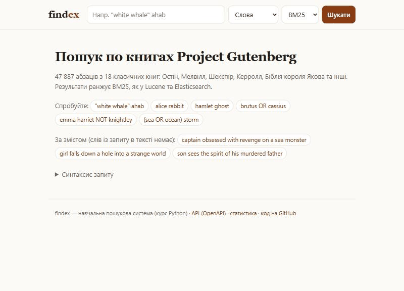
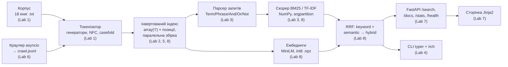

# findex

[](https://github.com/nerb1t/findex/actions/workflows/ci.yml)

**Пошукова система, написана з нуля на Python за 8 лаб: від генератора, що читає файли, до вебсервісу з BM25, булевою мовою запитів і семантичним пошуком.**

**Онлайн:** https://findex-0rmn.onrender.com · [API (OpenAPI)](https://findex-0rmn.onrender.com/docs) · [відео 2–3 хв](#відео) · безкоштовний сервер засинає без відвідувачів, перший запит після паузи може йти 30–60 s



| 47 887 | 15.6× | 111 ms |
|:---:|:---:|:---:|
| документів (абзаців) з 18 книг Project Gutenberg, 2.17 млн токенів | прискорення BM25 на NumPy проти Python-циклу (частий терм) | p95 на `/search` при 50 одночасних клієнтах (4 воркери, локально) |

## Що вміє

- **Мова запитів:** `(ahab OR starbuck) "white whale" NOT ship`. AND, OR, NOT, дужки, точні фрази (позиційний індекс).
- **Ранжування:** BM25 або TF-IDF, рахуються NumPy-масивами; сніпети з підсвіткою.
- **Три режими:** `keyword` (BM25), `semantic` (ембединги all-MiniLM-L6-v2, косинус) і `hybrid` (обидва рейтинги, злиті через Reciprocal Rank Fusion). «conspirators stab the roman ruler» знаходить «They stab Caesar.», хоча спільних слів майже немає.
- **CLI:** `findex index | search | stats | crawl | embed | serve`. Можна поставити однією командою, є rich-таблиці, `--json` для конвеєрів.
- **Асинхронний краулер:** робить те саме для будь-якого сайту — robots.txt, ліміти на хост, повтори з backoff.
- **Вебсервіс:** FastAPI + Jinja2, у Docker, розгорнутий на Render.

## Як воно влаштоване



## Запуск

```
uv sync
uv run python scripts/get_corpus.py                                     # 18 книг, ~12 MB
uv run findex index data/gutenberg -o index_arr.bin --kind array --positions
uv run findex embed index_arr.bin                                       # ~6 хв на CPU, або: cp embeddings/gutenberg.emb.npz index_arr.emb.npz
uv run findex search index_arr.bin '"white whale" ahab'
uv run findex search index_arr.bin "a girl follows a hurrying animal" --mode semantic
uv run findex serve --index index_arr.bin                               # http://127.0.0.1:8000
docker build -t findex . && docker run -p 8000:8000 findex
```

## Зведені виміри (Лаби 1–8)

Машина для всіх локальних замірів: Intel i7-11700K (8 ядер / 16 потоків), 16 GB, Windows 10, Python 3.13. Повні таблиці, методика й пояснення — у [`docs/labs.md`](docs/labs.md) (Lab 1–7), [`docs/profiling.md`](docs/profiling.md) і [`docs/semantic.md`](docs/semantic.md) (Lab 8).

**Lab 1 — генератори проти списків** (статистика корпусу):

| | Peak memory, 18 книг | Peak memory, 5 книг | Час |
|---|---:|---:|---:|
| eager (списки) | 122.7 MB | 70.5 MB | 3.63 s |
| lazy (генератори) | **9.8 MB** | **9.8 MB** | 3.73 s |

**Lab 2 — як зберігати 1.55 млн postings:**

| | Індекс у RAM | pickle | load |
|---|---:|---:|---:|
| `list[Posting]`, звичайний `@dataclass` | 176.2 MB | 38.2 MB | 1.09 s |
| `list[Posting]`, `slots=True` | 117.0 MB | 29.3 MB | 3.18 s |
| `array('I')` (doc_ids, tfs) | **41.2 MB** | 18.9 MB | **0.15 s** |

**Lab 3 / Lab 8 — якість, precision@5** (ручна розмітка; 10 запитів + 5 перефразів без слів із тексту):

| | TF-IDF | BM25 (keyword) | semantic | hybrid (RRF) |
|---|---:|---:|---:|---:|
| 10 запитів Lab 3 | **0.94** | 0.50 | 0.42 | 0.62 |
| 5 перефразів | — | 0.00 | 0.28 | 0.28 |

TF-IDF тут виграє через особливість корпусу: документ = абзац, і BM25 з `b=0.75` піднімає однорядкові репліки («Captain Ahab.»). Розмітка в Lab 8 доповнена документами, які знайшли нові режими, тож 0.94 і 0.50 рахувались на трохи різних наборах. Порівнювати варто стовпці в межах одного рядка.

**Lab 4 — інженерія:** pyright strict 0 помилок, **233 тести** (Hypothesis-властивості, CLI через `CliRunner`, MockTransport, TestClient), покриття 96%, CI на кожен push, `pytest-benchmark` у CI.

**Lab 5 — паралельна збірка індексу** (3.19 s послідовно):

| | 2 | 4 | 8 воркерів |
|---|---:|---:|---:|
| потоки, Python 3.13 (GIL) | 1.07× | 0.96× | 0.96× |
| процеси, Python 3.13 | 1.08× | **1.39×** | 1.38× |
| процеси, компактний `array` | 1.50× | 2.06× | **2.10×** |
| потоки, Python 3.14t (без GIL) | 1.50× | 1.87× | **2.03×** |

Стелю ставить послідовний `merge` (37% часу, закон Амдала ≤ 2.7×). I/O-навантаження (48 HTTP-запитів по 100 мс) потоки під GIL прискорюють у **40×**.

**Lab 6 — асинхронний краулер** (300 сторінок з локального дзеркала, одна нитка):

| concurrency | 1 | 5 | 20 |
|---|---:|---:|---:|
| час | 87.7 s | 13.0 s | **4.3 s** |
| пам'ять | 44 MB | 44 MB | 45 MB |

**Lab 7 — вебсервіс під навантаженням** (oha, `/search?q=the sea`):

| | клієнтів | RPS | p50 | p95 | p99 |
|---|---:|---:|---:|---:|---:|
| 1 воркер, `async def` | 50 | 171 | 282 ms | 371 ms | 464 ms |
| 1 воркер, `def` | 50 | 197 | 250 ms | 291 ms | 331 ms |
| 4 воркери | 50 | **553** | 93 ms | **111 ms** | 121 ms |
| Render Free (Lab 7) | 20 | 19 | 1096 ms | 1398 ms | 1497 ms |

**Lab 8 — NumPy-скорер** (той самий рейтинг до біта, перевірено тестом):

| Запит | Знайдено | Python-цикл (Lab 3) | NumPy | |
|---|---:|---:|---:|---:|
| `the` | 35 572 | 31.6 ms | 2.0 ms | **15.6×** |
| `sea OR ship OR whale` | 1 732 | 1.83 ms | 0.17 ms | 10.6× |
| `the white whale` | 108 | 1.33 ms | 0.40 ms | 3.4× |
| `leviathan` | 81 | 0.085 ms | 0.053 ms | 1.6× |
| `1816` | 1 | 0.007 ms | 0.033 ms | 0.2× (накладні витрати NumPy) |

**Lab 7 → 8 — пам'ять вебсервісу в Docker** (ліміт Render 512 MB):

| | RSS | load |
|---|---:|---:|
| Lab 7: `Posting`-об'єкти, pickle поштучно | 546 MB | 3.9 s |
| Lab 7: компактний pickle | 376 MB | 1.9 s |
| Lab 8: `array` + позиції **+ модель ембедингів** | 414 MB (пік 431) | 0.2 s |

## Обмеження

- **Корпус маленький:** 18 книг, ~48 тисяч абзаців, усе в пам'яті. Індекс не оновлюється частинами, лише повна перебудова. Ембединги рахуються пошуком перебором (`E @ q`); на мільйонах фрагментів потрібен ANN-індекс (HNSW).
- **Документ = абзац.** Через це BM25 любить короткі репліки, а запити «про героя» (`captain ahab`) мають низький precision у всіх режимах.
- **Модель англійська** (all-MiniLM-L6-v2) і погано розуміє правопис Шекспіра 1603 року. Токенізатор не робить стемінгу і не прибирає стоп-слова.
- **Безкоштовний Render:** частка одного ядра і 512 MB. 19 RPS проти 553 локально, сервер засинає без трафіку. Пам'яті лишається ~80 MB запасу.
- **Оцінка якості** — 15 запитів, розмічених мною: мала вибірка, тож числа шумні.
- **Краулер** обходив тільки моє локальне дзеркало. FIFO-черга без окремих черг на хост, тож за жорстких лімітів на хост він повільний.
- **pickle** вантажить лише власні файли: `pickle.load` на чужому файлі — це виконання чужого коду.

## Відео

Демо на 2–3 хвилини: _посилання буде тут_ (сценарій — [`docs/video-script.md`](docs/video-script.md)).

## Структура

```
src/findex/      tokenize, corpus, index, parallel, models, store, query, scoring, vector, search,
                 semantic, snippet, crawler/, web/, cli
tests/           233 тести (pytest, Hypothesis, CliRunner, MockTransport, TestClient, pytest-benchmark)
scripts/         бенчмарки й оцінка кожної лаби, локальне дзеркало сайту для краулера
docs/            звіти лаб, flame graphs, графік прискорення, GIF
embeddings/      ембединги корпусу (int8, 19 MB) — щоб Docker не рахував їх 6 хвилин
```
